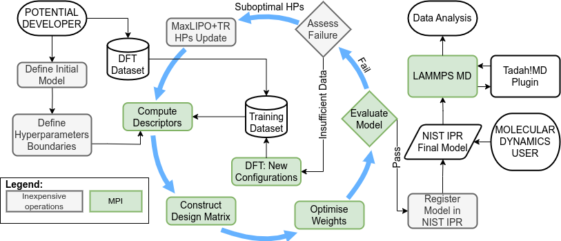

.. _hyperparameter_optimisation:

Hyperparameter Optimisation
---------------------------

A common challenge in developing machine learning interatomic potentials (MLIPs) is that while obtaining a model that performs well on static validation sets is relatively straightforward, it takes significant time to adjust a model for stable molecular dynamics (MD) trajectories. However, even such a model might not work well beyond the bounds of the training data.

Tadah! uses a physics-informed approach, where the model is iteratively improved based on MD simulation outcomes. Starting with models that fail and progressing to a working model, this process optimizes key features such as model complexity, resulting in increased computational performance and greatly increased transferability beyond the training dataset. The iterative process is performed automatically.

An external optimization loop tweaks the model's hyperparameters, which are then used to train the ML model and test it with MD simulations. This allows for automatic refinement with minimal user input.

To use Hyperparameter Optimisation (HPO), LAMMPS must be compiled with the Tadah! interface. Tadah! will link to this version of LAMMPS.

.. code-block:: bash

    tadah hpo -t <targets> -c <config_file> -v <config_validation>

HPO allows automatic model adjustments by running custom LAMMPS simulations, scoring them, and using these scores to guide the training process.

