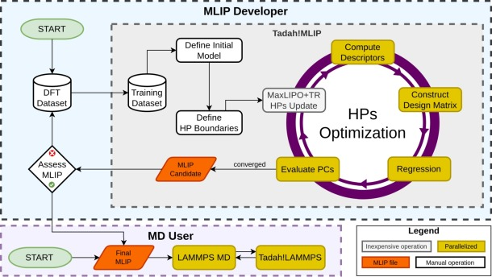

.. _nested_fitting:

Nested Fitting
==============

.. note::

   We use :term:`NFP` (Nested Fitting Procedure) and :term:`HPO`
   (Hyperparameter Optimization) interchangeably to refer to this feature.
   The main :term:`CLI` entry point is ``tadah hpo``.  *NFP* is preferred in
   prose to emphasise the two-level fitting structure that is specific to
   Tadah!MLIP; *HPO* is the spelling used by every keyword and source-file
   identifier.

   Workflow of the :term:`nested fitting procedure`: the outer optimiser
   proposes new :term:`hyperparameters<Hyperparameter>`, the model is
   retrained, and each trial potential is validated against
   :term:`performance constraints<Performance constraint>` that feed back
   into the global loss.

Nested fitting is Tadah!MLIP’s automated, two-level fitting workflow:

* **inner loop** — ordinary regression that determines the
  :term:`learned parameters<Learned Parameter>` :math:`\mathbf w` for a
  fixed model definition;
* **outer loop** — a global optimiser that samples from the
  :term:`search space constraints<Search Space Constraint>` (SSC),
  retrains the model, and judges the result against user-defined
  :term:`performance constraints<Performance constraint>` (PC).

Letting a computer search the :term:`hyperparameter` space helps to

* escape the “good on the validation set, unstable in MD” trap;
* trade accuracy for speed (or vice versa) in a reproducible way;
* fold real-world performance constraints — elastic constants, phase
  stability, surface energies, … — directly into the loss function.

Background
----------

A traditional MLIP workflow stops once regression converges on a
training/validation split.  Unfortunately, a potential that interpolates
perfectly may still

* disintegrate during an MD run,
* produce an incorrect equation of state,
* predict the wrong ground-state crystal,
* extrapolate poorly beyond the training set.

Manual hyperparameter tuning or simply enlarging the training set are
both tedious and not guaranteed to succeed.

Nested fitting tackles the problem by *measuring* emergent properties
during the fit.  Each trial potential is dropped into a short LAMMPS
run; the resulting quantities are compared to their targets and the
discrepancy contributes to a **global loss**

.. math::

  L_{\text{total}} = \sum_{i} w_i\;
                     \mathcal L_i\!\bigl(|y_i-\hat y_i|\bigr),

where :math:`w_i` is the user-supplied weight, :math:`y_i` the target,
:math:`\hat y_i` the prediction, and :math:`\mathcal L_i` one of the
built-in loss functions (L1, L2, Huber, Tukey, …).

The outer optimiser explores the hyperparameter space :math:`\Theta`
declared with the ``OPTIM`` directive:

.. math::

  \theta^\star
  = \operatorname*{arg\,min}_{\theta\in\Theta} L_{\text{total}}(\theta).

Because the model is retrained for every candidate :math:`\theta`, the
procedure is computationally expensive but also powerful: it can expose
regions of hyperparameter space that yield stable, accurate, and fast
potentials.  It is not a silver bullet — **success still depends on
sensible choices of performance constraints and search space limits.**

.. _nfp_quick_start:

Quick Start
-----------

Nested fitting needs up to three input files:

#. A :term:`training configuration` — the same configuration file you
   would use for ``tadah train``.  See :ref:`ConfigSection` for the
   full key list.
#. A *validation* file — a list of validation datasets passed via the
   ``DBFILE`` keyword.  *Optional*: only required when the loss uses
   validation-set metrics (``PC_ERMSE``, ``PC_FRMSE``, …); a run whose
   loss comes entirely from ``PC_OBSERVABLE`` / ``PC_LAMMPS`` lines can
   omit ``--validation``.
#. An :term:`HPO configuration` — the file documented on this page.
   Conventionally named ``config.hpo``.

The training configuration's ``DBFILE`` is itself *optional* when every
model weight is pinned via ``FIXINDEX``/``FIXWEIGHT`` (see
:ref:`hpo_fixweight`) — with no free weights there is nothing for the
least-squares stage to fit.  In that mode the element set must be
declared explicitly with the ``ATOM`` key, at least one loss source must
remain, and the run is serial-only (MPI builds reject it).

The driving command line is

::

   tadah hpo --config <config.train> --hpotarget <config.hpo> --validation <config.val>

A minimal ``config.hpo``:

.. code-block:: none

   OPTIMIZER
     STRATEGY
       TYPE PLAIN
       LIB DLIB
       ALGO BFGS
       MAXEVAL 50
     ENDSTRATEGY
   ENDOPTIMIZER

   LOSS L2
   PC_ERMSE 0 1.0
   OPTIM RCUT2B (1) 4.0 6.0

See :ref:`cli_example_2` for a slightly bigger walkthrough, and
:ref:`hpo_examples` for a graded series of fifteen worked examples.

.. _nfp_manual:

Configuration file
------------------

This section is the reference for the HPO configuration file.  For an
even terser keyword reference — every flag, every default, plus the
*OPTIM-able context keys* table — see the in-tree `HPO/README.md
<https://git.ecdf.ed.ac.uk/tadah/hpo/-/blob/develop/README.md>`_.

Block hierarchy
...............

The HPO configuration is a sequence of *root-level* keywords (``LOSS``,
``OPTIM``, ``PC_*``, ``OUTPUT``, …) plus a single ``OPTIMIZER``
``ENDOPTIMIZER`` block.  The optimiser block has nested blocks, listed
in the order they normally appear:

.. code-block:: none

   OPTIMIZER
     INIT       ... ENDINIT          # optional: seeding strategy chain
     NOISE      ... ENDNOISE         # optional: objective-noise calibration
     STRATEGY   ... ENDSTRATEGY      # required: TYPE + driver + decorators
       EXPLORE  ... ENDEXPLORE       # required for TYPE PRESTAGE
       REFINE   ... ENDREFINE        # required for TYPE PRESTAGE
       INNER    ... ENDINNER         # optional: NLopt MLSL/AUGLAG inner
       RESTART  ... ENDRESTART       # optional decorator
   ENDOPTIMIZER

Block keywords are case-sensitive.  Comments start with ``#``; long
lines may be continued with a trailing ``\``.

A legacy form without a ``STRATEGY`` block — ``LIB``/``ALGO``/``MAXEVAL``
written directly inside ``OPTIMIZER`` — is still accepted and behaves
exactly like ``STRATEGY { TYPE PLAIN ... }``.  It is fine for short
single-shot runs but cannot express ``MULTISTART``, ``PRESTAGE``,
init chains, or ``RESTART`` decorators; those features
require the explicit grammar.

.. _loss_functions:

LOSS — global loss function
...........................

::

   LOSS <Name> [<extra params>]

The default loss applied to every metric that does not override it.
``PC_LAMMPS`` per-variable lines may pick a different loss locally.

================ =============== ==============================
Name             Extra params    Comment
================ =============== ==============================
``L1``           —               :math:`|x|`
``L2``           —               :math:`x^2`
``HUBER``        ``δ``           quadratically near zero, linear beyond δ
``TUKEY``        ``c``           redescending, zero influence for ``|x| > c``
``LOG_COSH``     —               smooth alternative to L1
``RMSLE``        —               log-scaled L2 (non-negative targets)
================ =============== ==============================

Root-level loss control:

.. list-table::
   :header-rows: 1
   :widths: 25 75

   * - Key (type)
     - Description
   * - ``FAILSCORE`` (float)
     - Cap on total loss; values above are clipped (default: max
       double).  May be overridden per-script with ``--failscore`` on
       a ``PC_LAMMPS`` line.

.. _search_space_constraints:

OPTIM — search space constraints
................................

The ``OPTIM`` directive declares which configuration keys the outer
optimiser may vary, and over what bounds:

.. code-block:: none

   OPTIM <KEY> (indices) <low> <high>

* ``<KEY>`` — any optimisable key from the training configuration.  For
  the full list of OPTIM-safe keys (and the tightly enumerated set of
  *unsafe* ones, e.g. ``RCUT2B`` with ``D2_EAM``), see the
  *OPTIM-able context keys: reinit-safety reference* table in
  `HPO/README.md
  <https://git.ecdf.ed.ac.uk/tadah/hpo/-/blob/develop/README.md>`_.
* ``(indices)`` — selects a subset of the values bound to ``<KEY>``.
  Indices follow the order in the training configuration and start
  from **1**.  Comma-separated lists, ranges ``a-b``, and strides
  ``a-b:s`` are all accepted (e.g. ``(1,4,7-10:2)``).
* ``<low>``, ``<high>`` — floating-point bounds.  ``high`` must be
  strictly greater than ``low``.

``OPTIM`` lines may be repeated for the same key with different indices.

Two weight-related special cases:

* ``OPTIM FIXWEIGHT`` — the ``(indices)`` name **model weights** (the
  weights ``FIXINDEX`` pins), *not* positions in the ``FIXWEIGHT`` value
  list.  ``OPTIM FIXWEIGHT (5) -1 1`` searches model weight 5 and it is
  an error if 5 is not listed in ``FIXINDEX``.  See :ref:`hpo_fixweight`.
* ``OPTIM WEIGHTS`` — **rejected**.  The linear ``WEIGHTS`` are re-fitted
  by least squares on every evaluation, so optimising them directly
  would be a silent no-op; pin them with ``FIXINDEX``/``FIXWEIGHT``
  instead.

.. _hpo_knot_rcut:

Cutoffs of knot-family refit potentials
.......................................

For potentials written by ``tadah refit`` with the knot basis families
(``D2_Knot5`` two-body, ``DM_REAM`` knot density), the effective cutoff
**is the largest knot position**: each knot function :math:`(t-r)_+^k`
vanishes smoothly at its own knot, so ``RCUT2B``/``RCUTMB`` are *derived*
quantities (see :ref:`refit_rcut_contract`).  ``tadah hpo`` enforces this
automatically:

* at startup, a stated ``RCUT`` that differs from the largest knot is
  corrected (with a warning) before anything is built;
* on **every evaluation**, the ``RCUT`` keys are re-derived from the
  current (possibly ``OPTIM``'d) knot positions, so searching
  ``OPTIM CGRID2B`` / ``CGRIDMB`` moves the effective cutoff with the
  knots;
* the neighbour list is sized **once** for the largest cutoff the search
  can reach — including the upper bounds of any ``OPTIM`` block on the
  knot grids — so no evaluation can silently outrun it.

Consequently ``OPTIM RCUT2B`` / ``OPTIM RCUTMB`` on a knot-family
potential is a *wasted search dimension* (the value is overridden each
evaluation; a startup warning says so).  To search the effective cutoff,
put an ``OPTIM`` block on the knot positions instead — e.g. uncomment the
``OPTIM CGRID2B`` line of the outermost knot in the refit-generated
hpotarget and widen its upper bound.

Blip-family potentials are unaffected: their hard truncation at the
stated ``RCUT`` is part of the fitted model, so the key remains
authoritative (warnings fire if ``OPTIM`` bounds let a blip's support
cross it).

.. _hpo_fixweight:

Pinning and searching linear coefficients
.........................................

By default the model's linear ``WEIGHTS`` are re-fitted by least squares
inside **every** objective evaluation, while ``OPTIM`` searches the
nonlinear hyperparameters.  ``FIXINDEX``/``FIXWEIGHT`` in the *training
configuration* carve weights out of that LS fit: pinned columns are
removed from the design matrix, their contribution is subtracted from
the target, and the remaining weights are fitted against the residual.
The i-th ``FIXWEIGHT`` value pins the weight named by the i-th
``FIXINDEX`` entry; a lone key is an error, and ``NORM true`` is
incompatible with pinning (the values would live in normalized feature
space).

**Mixed mode** — LS-fit most weights, hold one, search another.  With a
5-weight model: weights 1–3 LS-fitted, weight 4 held at 0.75, weight 5
searched by the optimiser:

.. code-block:: none

   # training configuration (config.train)
   DBFILE    train.tadahdb
   FIXINDEX  4 5
   FIXWEIGHT 0.75 1.20        # 0.75 pins w4; 1.20 seeds w5

   # config.hpo
   OPTIM FIXWEIGHT (5) -2.0 2.0    # (5) = model weight 5

**All-fixed polish** — the ``tadah refit`` workload.  ``FIXINDEX`` covers
every weight, so the LS solve is vacuous and skipped (including the
per-evaluation design-matrix build); the optimiser searches the
coefficients directly:

.. code-block:: none

   FIXINDEX  1-28
   FIXWEIGHT <28 fitted values>
   # config.hpo: one OPTIM FIXWEIGHT (i) line per coefficient
   # (this is exactly what `tadah refit` emits as refit.hpotarget)

**No training data** — with every weight pinned, the training ``DBFILE``
may be omitted entirely.  Declare the element set with ``ATOM`` and keep
at least one loss source (``--validation`` metrics, ``PC_OBSERVABLE``,
or ``PC_LAMMPS``):

.. code-block:: none

   # config.train: a fitted potential, no DBFILE line
   ATOM      Ta
   FIXINDEX  1-28
   FIXWEIGHT <28 values>

   # config.hpo
   PC_LAMMPS --script Ecoh.in --hotvar hot_a0 2.5 4.5 3.302 --varloss Ecoh 8.10 800
   OPTIM FIXWEIGHT (1-28) ...

   # command line: --validation may be omitted
   tadah hpo -c config.train --hpotarget config.hpo

This mode is serial-only (MPI builds reject it — there is no design
matrix to distribute).  Misconfigurations (lone keys, size mismatches,
out-of-range indices, missing loss sources, incomplete pin coverage
without a ``DBFILE``) are rejected at startup with actionable messages.

With ``FIXINDEX`` present, analytical/HYBRID gradient strategies fall
back to finite differences for all parameters: the analytical chain
assumes the unconstrained LS solution map, which pinning invalidates.
Derivative-free algorithms (e.g. ``NLOPT LN_BOBYQA``) are a natural
choice for coefficient searches.

.. _performance_constraints:

PC_* — performance constraints
..............................

Energy / force / stress validation metrics
~~~~~~~~~~~~~~~~~~~~~~~~~~~~~~~~~~~~~~~~~~

Validation-set metrics are evaluated on every ``DBFILE`` listed in the
``--validation`` file.  Each line takes a target value and a weight:

.. code-block:: none

   PC_<METRIC> <target> <weight>

================== =================================================================
Key                Quantity
================== =================================================================
``PC_EMAE``        Energy mean absolute error (per atom)
``PC_ERMSE``       Energy root-mean-square error (per atom)
``PC_ErRMSE``      Energy *relative* RMSE
``PC_ERSQ``        Coefficient of determination (R²) for energies
``PC_FRMSE``       Force component RMSE
``PC_SRMSE``       Stress component RMSE
================== =================================================================

These constraints use the global ``LOSS`` selected above.

Physics-informed constraints (PC_LAMMPS)
~~~~~~~~~~~~~~~~~~~~~~~~~~~~~~~~~~~~~~~~

``PC_LAMMPS`` runs a regular LAMMPS script against each trial potential
and feeds one or more LAMMPS *equal-style* variables back into the
loss:

.. code-block:: none

   PC_LAMMPS --script in.mysim \
             --varloss myVar       0   100 \
             --varloss myOtherVar 145    10

A long ``PC_LAMMPS`` line may be split with a trailing back-slash
(``\``).  Tadah!MLIP creates an isolated ``LAMMPS_NS::LAMMPS`` instance
per script per worker thread; instances are reused across iterations
(the script's own ``clear`` directive resets simulation state between
runs, so existing scripts work unmodified).

Required options
^^^^^^^^^^^^^^^^

``--script <file>``
   LAMMPS input file containing the variable definitions.

``--varloss <name> <target> <weight> [loss-type p₁ p₂ …]``
   The variable ``<name>`` (defined inside the LAMMPS script) is read
   at the end of the run and combined with ``<target>`` and
   ``<weight>`` via the global ``LOSS`` (or the per-line override).
   Optional trailing tokens override the loss for this variable only.

Additional options
^^^^^^^^^^^^^^^^^^

``--invar <name> <value>``
   Inject a variable (equivalent to LAMMPS' ``-var`` flag), letting the
   same script be reused for several structures or pressures.

``--outvar <name>``
   Record the variable in ``outvar.tadah`` without contributing to the
   loss.  Useful for diagnostic plots.

``--failscore <value>``
   Override the global ``FAILSCORE`` for this script.  If LAMMPS
   crashes or the loss exceeds this value the optimiser receives
   ``FAILSCORE`` for the whole iteration.

``--ncpu <m>``
   Request *m* MPI ranks for this script in MPI builds.  In the
   default serial build the option is parsed and accepted but does
   not change runtime; HPO logs a stderr warning when ``--ncpu > 1``
   is set in a non-MPI build.  See :ref:`performance_parallelism`.

``--hotvar <name> <min> <max> [<initial>]``
   Declare this ``PC_LAMMPS`` line as *hot*: a two-phase evaluator
   for parameters that other scripts depend on. Hot scripts run
   alone in **phase A** of each iteration (in parallel with other
   hot scripts), expose ``variable <name> string …`` from the
   LAMMPS script (see :ref:`warmstart_protocol` for the required
   ``string``-style readback), and the returned value is validated
   against ``[min, max]``. Validated values are cached per
   ``(script, name)`` and propagated as ``${<name>}`` strings into
   every cold (no-``--hotvar``) ``PC_LAMMPS`` script in **phase B**.
   ``<initial>`` is optional; when omitted the midpoint of
   ``[<min>, <max>]`` seeds the first iteration. If a hot value
   lands outside ``[min, max]`` HPO fail-scores the iteration and
   skips phase B (a *graded* failure when ``FAILSCORE_GRADING ON``
   — see :ref:`failscore_grading`).

``--failvar <name> [<scale>]``
   Declare a *violation variable*: a nonnegative LAMMPS ``equal``-style
   variable that is ``0`` when the simulation vouches for itself and
   ``> 0`` when it failed, with the magnitude measuring *how badly*
   (natural units; ``<scale>`` converts to the dimensionless failure
   measure, default 1). When it reads ``> 0`` the sim is treated as
   failed, its outvars are excluded from the fit, and — with
   ``FAILSCORE_GRADING ON`` — ``scale × value`` grades the failure
   loss so the optimiser is pulled toward feasibility instead of
   hitting a constant. Define it **early** in the script (right after
   the risky command), so it is still readable when a later section
   times out. Like ``--varloss``/``--outvar`` names, the variable must
   be defined in the script as an ``equal``-style variable — a typo'd
   name is a startup error, not a silently-disabled check. Replaces
   the old “sentinel value” idiom (returning ``-1000`` as fake data).
   See :ref:`failscore_grading`.

Per-metric bad-pot pre-filter
^^^^^^^^^^^^^^^^^^^^^^^^^^^^^

``PC_<METRIC> --skip-above <cap>`` and ``PC_<METRIC> --skip-rel <ratio>``
attach a per-metric pre-filter on the dataset error counters
(``PC_EMAE``, ``PC_ERMSE``, ``PC_ErRMSE``, ``PC_ERSQ``, ``PC_FRMSE``,
``PC_SRMSE``).  Both gates fire **before** any ``PC_LAMMPS`` work for
the iteration:

* ``--skip-above <cap>`` fail-scores the iteration when the metric
  exceeds the absolute ``<cap>``.
* ``--skip-rel <ratio>`` fail-scores when
  ``metric > ratio × running_best`` for that same metric.

Both filters can be applied to the same metric line.  They short-cut
obviously bad potentials so wall-time is not spent on LAMMPS phases
that would never compete.

Result contract for user scripts
^^^^^^^^^^^^^^^^^^^^^^^^^^^^^^^^

LAMMPS scripts driven by HPO must communicate their results back
*only* through ``--varloss`` / ``--outvar`` (LAMMPS ``equal``-style
variables).  They should avoid writing files (dumps, restarts,
``write_data``, custom logs) unless filenames are made unique, because
all shared-pool workers (and isolated worker processes) use the same
working directory.

If ``-log <file>`` or ``-screen <file>`` is supplied explicitly inside
a ``PC_LAMMPS`` entry, HPO appends ``.t<worker_slot>`` per shared-pool
slot (and the MPI rank suffix when applicable), so for example
``-log run.log`` becomes ``run.log.t0``, ``run.log.t1``, … on one rank.
``-log none`` and ``-screen none`` are left untouched.

.. _failscore_grading:

Failure handling — graded FAILSCORE
~~~~~~~~~~~~~~~~~~~~~~~~~~~~~~~~~~~

What problem this solves
^^^^^^^^^^^^^^^^^^^^^^^^

When a candidate potential makes a simulation fail — a relaxation that
does not converge, a hot value outside its window, a hung run that had
to be killed — the iteration traditionally returns the constant
``FAILSCORE``.  A constant is a *flat* landscape: inside a failing
region every proposal looks equally bad, so annealers random-walk or
freeze (their step-size adaptation has two absorbing states on a flat
or cliff-edged landscape), parallel-tempering ladders die on the
plateau, and gradient methods see exactly zero slope.  The optimiser
receives no hint of *which way is out*.

``FAILSCORE_GRADING ON`` replaces the constant with a **graded** value:
each gradable failure returns a loss inside the reserved band
``[0.999 × FAILSCORE, FAILSCORE)`` that *decreases as the candidate
gets closer to working*.  Feasible results always win (they are orders
of magnitude below the band).  The annealing family ranks finite values
inside the band in its Metropolis decisions and chain/walker personal-best
updates, so their ordering supplies a downhill path toward feasibility.
Operations that require a genuinely feasible sample remain stricter:
``STOPVAL``, the Corana ``FTOL`` plateau, T0 calibration, and PA population
weighting/resampling classify the entire reserved band as failed.  Thus a
failure value cannot report convergence; PA gives a graded walker zero
resampling weight whenever a feasible walker exists, while an all-failed
population skips resampling and continues cooling.

The knobs, most important first
^^^^^^^^^^^^^^^^^^^^^^^^^^^^^^^

``FAILSCORE <value>`` (root)
   The failure ceiling, as before — but with grading ON it **must** be a
   finite positive number below ``1e300`` (e.g. ``1e9``), large enough
   that all four grading bands are strictly representable; the legacy
   ``DBL_MAX`` default and unrepresentable tiny values are rejected at
   startup.  Choose it a few orders of magnitude above your worst
   plausible *real* loss.

``FAILSCORE_GRADING ON|OFF`` (root, default ``OFF``)
   The master switch.  ``OFF`` is byte-identical to the legacy
   behaviour.  Everything below only matters when this is ``ON``.
   Environment override: ``TADAH_FAILSCORE_GRADING=ON|OFF``.

``--failvar <name> [<scale>]`` (per ``PC_LAMMPS`` line)
   The per-script violation channel (see the option reference above and
   the examples below).  Costs one ``variable`` line per script and
   upgrades that script's failures from “counted” to “measured”.

``PC_FAILPROBE --script <f> --outvar <S> [--gate <T>] [--s0 <v0>]`` (root)
   A tiny, minimiser-free *sanity probe* executed at the front of every
   iteration's parallel batch.  Its first ``--outvar`` is a single
   nonnegative scalar ``S`` measuring how unphysical the candidate is
   (0 = sane).  ``S`` becomes the failure measure for the failure modes
   that cannot measure themselves — hung runs that were killed, crashed
   potential builds — and, optionally, a **gate**: when ``S > <T>`` the
   iteration is short-circuited before wasting the full simulation
   budget.  ``<v0>`` must be finite and strictly positive; it sets the
   saturation scale of the grading curve for ``S`` (default 1; a good
   choice is the seed potential's ``S`` times a small factor).  At most
   one probe line is allowed; ``--varloss``
   on it is rejected (the probe grades failures — it must not shape the
   feasible objective).

``--gate <T>`` (on ``PC_FAILPROBE``)
   **The only knob that needs real care.**  If the gate can fire on a
   candidate that would actually have succeeded, you have changed the
   objective, not just saved time.  Calibrate it from a short run:
   journal the ``S`` statistics of accepted iterations, then set ``T``
   far above anything a feasible candidate produces (same philosophy as
   the ``--skip-above`` caps).  Gate firings are journaled and
   rate-limited; watch the counter.

``PC_WORKER_TIMEOUT`` / per-sim ``--maxtime`` (existing)
   Unchanged, but they *interact*: a killed hung run is graded by ``S``
   (band C below), so with a probe defined even timeouts become
   directional instead of flat.

Order of firing within one iteration
^^^^^^^^^^^^^^^^^^^^^^^^^^^^^^^^^^^^

::

   train/validate  →  [skip caps?  → graded band D, stop]
   dispatch batch:  FAILPROBE first (cheapest → returns first),
                    hot scripts + independent cold scripts alongside
     ├─ probe returns S
     │    ├─ S ≤ gate (or no gate): S is stored for later grading
     │    └─ S > gate: iteration short-circuited → band D graded by S;
     │       queued sims are cancelled; in PROCESS mode this
     │       iteration's in-flight sims are killed (other concurrent
     │       iterations on the shared pool are never touched)
     ├─ each sim finishes → failvars read (0 ⇒ OK; >0 ⇒ band B, graded)
     │    hot values validated → out of window ⇒ band A, graded by the
     │    normalized distance to [min, max]
     ├─ a sim times out in-script (timer timeout) → instance still
     │    alive → failvars still readable → band B
     └─ a sim hangs → parent deadline kill (PROCESS mode) → nothing
          readable → band C, graded by S
   dependent cold wave → loss assembly:
     no failure  → normal loss (identical to grading OFF)
     any failure → L_fail in [0.999·FS, FS), see the band table

The severity bands (worst on top) encode the natural *repair path* —
make the potential sane, then runs complete, then outputs valid, then
windows satisfied, then feasible:

.. list-table::
   :header-rows: 1
   :widths: 8 46 46

   * - Band
     - Failure modes
     - Graded by
   * - D
     - probe gate fired; potential build crashed; skip caps
     - ``S`` (probe) / metric excess (caps)
   * - C
     - run hung and was killed; worker died
     - ``S`` (probe)
   * - B
     - run completed but failed: in-script timeout, ``--failvar > 0``,
       unreadable/NaN outputs
     - failvar sum + failed fraction
   * - A
     - hot value outside its window
     - normalized distance to the window

Cross-band ordering is fixed (every ``A`` value beats every ``B``
value, etc.), within a band less violation is strictly better, and one
iteration gets exactly one band (the worst one that occurred).
Failures that are *not the potential's fault* — a LAMMPS instance that
could not be created, worker crash-loops — are deliberately **not**
graded (a directionless constant), so the optimiser never chases
infrastructure noise.

Designing ``failprobe.in``
^^^^^^^^^^^^^^^^^^^^^^^^^^

Four rules make a good probe:

1. **It must not be able to fail or hang.**  Single-point evaluations
   only: fixed cells, ``run 0`` — no ``minimize``, no ``box/relax``,
   no dynamics.
2. **It must be smooth in the potential parameters.**  Build ``S`` from
   hinge/softplus penalties of energies, forces and stresses — these
   are smooth functions of the parameters, so ``S`` gives a descent
   direction.
3. **It must be cheap** — a few small single-point cells cost
   milliseconds and disappear into the parallel batch.
4. **No ``label``/``jump`` loops.**  Scripts are executed
   command-by-command through the LAMMPS library interface, where the
   file-rewind machinery behind ``jump`` does not work reliably (it
   can half-work in ways that depend on leftover loop variables from
   the *previous* evaluation in the cached instance).  Unroll the few
   cells you probe — it is also easier to read.

Good ingredients (all already proven in the ``pen_*`` observables):
equation-of-state sanity (energy at a handful of fixed volumes around
equilibrium: hinge on non-monotonic compression branches), near-zero
forces on the ideal lattice, finite and positive stress response.  A
ready-to-adapt example:

.. code-block:: bash

   # failprobe.in — minimiser-free sanity scalar S for bcc metal.
   # Contract: NEVER minimize/box-relax/run>0; define S even on the
   # weirdest potential; keep it O(ms); no label/jump loops (rule 4) —
   # the three volumes are unrolled. `variable X equal $( ... )`
   # captures the value IMMEDIATELY, and equal-style redefinition
   # replaces the old value, so the captures stay fresh in the cached
   # instance on every evaluation.

   # -- E(V) monotonicity: 2-atom bcc cells at 0.90/1.00/1.10 a0 -----
   # (a0 = 3.30 reference lattice constant, baked into the lattice
   #  commands below)
   clear                    # scripts run in a CACHED LAMMPS instance:
                            # always start with clear (variables survive)
   units metal
   dimension 3
   boundary p p p
   atom_style atomic
   atom_modify map array
   lattice bcc $(3.30*0.90)
   region box block 0 1 0 1 0 1
   create_box 1 box
   create_atoms 1 region box
   mass 1 180.95
   pair_style tadah
   pair_coeff * * EXTERN Ta
   run 0 post no
   variable e_m10 equal $(pe/atoms)     # captured now (immediate $)

   clear
   units metal
   boundary p p p
   atom_style atomic
   atom_modify map array
   lattice bcc 3.30
   region box block 0 1 0 1 0 1
   create_box 1 box
   create_atoms 1 region box
   mass 1 180.95
   pair_style tadah
   pair_coeff * * EXTERN Ta
   run 0 post no
   variable e_0 equal $(pe/atoms)

   clear
   units metal
   boundary p p p
   atom_style atomic
   atom_modify map array
   lattice bcc $(3.30*1.10)
   region box block 0 1 0 1 0 1
   create_box 1 box
   create_atoms 1 region box
   mass 1 180.95
   pair_style tadah
   pair_coeff * * EXTERN Ta
   run 0 post no
   variable e_p10 equal $(pe/atoms)

   # compressed branch must rise toward small volume; expanded branch
   # must rise toward large volume (bound state). Hinge each violation.
   variable h_comp equal $(ternary(v_e_m10<v_e_0, v_e_0-v_e_m10, 0.0))
   variable h_exp  equal $(ternary(v_e_p10<v_e_0, v_e_0-v_e_p10, 0.0))

   # -- force sanity: rattle a cell DETERMINISTICALLY (fixed seed) and
   # hinge on absurd forces. Do NOT probe fmax on the ideal lattice --
   # there it is zero by symmetry for ANY potential, sick or sane.
   clear
   units metal
   boundary p p p
   atom_style atomic
   atom_modify map array
   lattice bcc 3.30
   region box block 0 2 0 2 0 2
   create_box 1 box
   create_atoms 1 region box
   mass 1 180.95
   pair_style tadah
   pair_coeff * * EXTERN Ta
   displace_atoms all random 0.05 0.05 0.05 12345 units box
   run 0 post no
   variable h_frc equal $(ternary(fmax>20.0, fmax-20.0, 0.0))

   # -- compose S: bounded, nonnegative, 0 for a sane potential ------
   variable S equal $(v_h_comp + v_h_exp + v_h_frc)

with the configuration line

.. code-block:: none

   FAILSCORE_GRADING ON
   PC_FAILPROBE --script pc_lammps/failprobe.in --outvar S --s0 0.5
   # add "--gate 50" ONLY after calibrating S statistics on your seed

(Adapt the element, ``a0``, volumes and thresholds to your system; add
Born-stability hinges via finite-difference stress probes on fixed
strained cells if shear stability matters for your fits — the
``pen_born`` machinery in the examples shows the pattern.)

``--failvar`` recipes for typical scripts
^^^^^^^^^^^^^^^^^^^^^^^^^^^^^^^^^^^^^^^^^

**Pressure-target relaxation** (``box/relax`` at pressure ``P``): the
convergence check already computes the violation — export it:

.. code-block:: bash

   fix relax all box/relax iso ${P_bar} vmax 0.003
   minimize 1e-10 1e-10 2000 20000
   unfix relax
   variable Pres equal $(press)*1.0e-4
   # 0 when converged within 1 GPa; the residual (GPa) otherwise:
   variable fail_press equal $(ternary(abs(v_Pres-v_P_GPa)<1.0, 0.0, abs(v_Pres-v_P_GPa)))
   # ... only now compute the real observables ...

.. code-block:: none

   PC_LAMMPS --script pc_lammps/elastic_P_single.in --invar P 300 \
       --varloss Cp_P300 232.8 7.6 --varloss C44_P300 332.9 3.9 \
       --failvar fail_press 0.01

**Minimisation that must actually converge** (vacancy, surface,
stacking-fault energies): grade by the residual force instead of
returning a sentinel:

.. code-block:: bash

   minimize 1e-10 1e-10 2000 20000
   # 0 when converged; the residual max force (eV/Å) otherwise:
   variable fail_fmax equal $(ternary(fmax<1.0e-8, 0.0, fmax))

.. code-block:: none

   PC_LAMMPS --script pc_lammps/vac_bcc_P_fast.in ... --failvar fail_fmax 10

Both patterns follow the same contract: **define the failvar
immediately after the risky command** (it survives a later in-script
timeout), keep it ``0`` on success, and make its magnitude the natural
physical distance from success.  Where your scripts currently return
sentinel values (``-1000``) as fake observables, move that logic into a
``--failvar`` — the sentinel stops polluting the fitted region and its
information starts steering the optimiser instead.

Setup effort, honestly
^^^^^^^^^^^^^^^^^^^^^^

Level 0 (just ``FAILSCORE_GRADING ON``): hot-window rejections and
partial failures become graded automatically — no script changes, and
the worst optimiser pathologies (plateau death, step-size collapse)
disappear.  Level 1 (one ``--failvar`` line per script that has a
convergence check): minutes per script.  Level 2 (the probe): one
script, once, assembled from the same hinge idioms as the ``pen_*``
observables.  The only knob that can *change your objective* if set
carelessly is the probe ``--gate`` — leave it off until you have
calibrated ``S``.

OPTIMIZER block — common attributes
...................................

The driver-attribute keys below are accepted wherever an
``OptimizerSpec`` is the active receiver: at the top level of
``STRATEGY`` (when ``TYPE`` is ``PLAIN`` or ``MULTISTART``) and inside
``EXPLORE``, ``REFINE``, and ``INNER`` sub-blocks.

.. list-table::
   :header-rows: 1
   :widths: 22 78

   * - Key (type)
     - Description
   * - ``LIB`` (string)
     - Optimisation library: ``DLIB``, ``NLOPT``, ``TADAH``, ``CERES``.
   * - ``ALGO`` (string)
     - Algorithm (see table below).
   * - ``MAXEVAL`` (uint)
     - Maximum number of evaluations.
   * - ``MAXTIME`` (uint)
     - Whole-optimiser wall-time in seconds for this active driver.  This is
       distinct from root-level ``PC_SCRIPT_TIMEOUT`` (whose legacy alias is
       root-level ``MAXTIME``).
   * - ``STOPVAL`` (float)
     - Stop when the loss falls below this value.
   * - ``FTOL_REL`` (float)
     - Relative tolerance on the loss.
   * - ``FTOL_ABS`` (float)
     - Absolute tolerance on the loss.
   * - ``XTOL_REL`` (float)
     - Relative tolerance on hyperparameters.
   * - ``XTOL_ABS`` (float)
     - Absolute tolerance on hyperparameters.
   * - ``POPULATION`` (uint)
     - Population size for population-based algorithms.
   * - ``STEP`` (float)
     - Algorithm-specific initial step.  For annealing this is the CLASSIC
       Gaussian sigma or the requested Corana uniform half-width ``V``
       (before its floor/cap clamp).
   * - ``SEED`` (uint)
     - Random seed (default: current time).  Inside an ``INIT`` block
       the same key seeds the stochastic init strategies instead.
   * - ``VECTOR_ARR`` (uint)
     - Storage size required by some NLOpt algorithms.
   * - ``THREADS`` (uint)
     - Outer thread count for ``DLIB:GFS`` (default: 1).
   * - ``PARAM`` (string float)
     - Generic key/value passed to the algorithm (e.g.
       ``PARAM fd_step 1e-3``).

.. list-table:: Algorithms by library
   :header-rows: 1
   :widths: 12 88

   * - LIB
     - ALGO (algorithms from the selected library)
   * - ``TADAH``
     - ``RANDOM`` (uniform random search), ``GRID``, ``ANNEAL`` (classic
       Kirkpatrick/Metropolis Simulated Annealing — see
       :ref:`tadah_anneal_block` below), ``ANNEAL_PT`` (parallel
       tempering, :ref:`tadah_anneal_pt_block`), ``ANNEAL_PA``
       (population annealing, :ref:`tadah_anneal_pa_block`).
   * - ``NLOPT``
     - All gradient-free NLOpt globals (``GN_*``) and locals (``LN_*``)
       — see the `NLOpt algorithm catalogue
       <https://nlopt.readthedocs.io/en/latest/NLopt_Algorithms/>`_ for
       the full list. Gradient-using algorithms (``GD_*`` / ``LD_*``)
       route through the shared finite-difference gradient seam used by
       ``DLIB:BFGS`` and the Ceres drivers; ``LD_LBFGS`` is the only
       member exercised by the bundled examples.

       .. note::

          **Analytical loss gradients are work in progress** and are
          not enabled in this beta release. Every gradient-using
          algorithm (``LD_*``, ``GD_*``, ``DLIB:BFGS``, all CERES
          drivers) currently obtains its gradient through numerical
          finite differences (see ``PARAM fd_step`` below).
   * - ``DLIB``
     - ``BFGS``, ``LBFGS``, ``CG``, ``BOBYQA`` (local), ``GFS`` (the
       dlib MaxLIPO+TR global *Global Function Search*).
   * - ``CERES``
     - ``LBFGS`` (limited-memory BFGS, Wolfe line search), ``WOLFE``
       (full BFGS, Wolfe line search), ``NLCG`` (nonlinear conjugate
       gradient), ``STEEPEST_DESCENT`` (Armijo line search). All four
       use Ceres' ``GradientProblemSolver``; the gradient is computed
       numerically via Ceres' ``DynamicNumericDiffCostFunction`` (central
       differences; step size from ``PARAM fd_step``).  The Ceres NLLS
       family (``LEVENBERG_MARQUARDT``, ``DOGLEG``, ``SUBSPACE_DOGLEG``)
       is **deferred** — mathematically degenerate over a scalar HPO
       loss; it will be enabled in a later phase together with
       residual-mode loss exposure. Ceres optimisers do **not** enforce
       box constraints; use ``DLIB:BFGS`` or ``NLOPT:LD_LBFGS`` for
       bounds-enforced gradient optimisation.

CERES PARAM keys
~~~~~~~~~~~~~~~~

The four CERES algorithms accept these algorithm-specific ``PARAM``
entries (all keys are optional unless noted):

================== =================================================================================
Key                Effect
================== =================================================================================
``fd_step``        Relative finite-difference step for the numerical gradient (default ``1e-6``).
``diff_method``    Numeric-diff method: ``0`` = CENTRAL (default), ``1`` = FORWARD, ``2`` = RIDDERS.
                   RIDDERS extrapolates assuming a smooth Taylor expansion; not recommended near
                   ``FAIL_SCORE`` plateaus or for noisy LAMMPS-loss components.
``tol_gradinf``    Gradient-infinity-norm convergence tolerance (Ceres ``gradient_tolerance``,
                   default ``1e-10``).
``max_iter``       Override on Ceres' ``max_num_iterations``.  By default the iteration cap is set
                   to a large sentinel and ``MAXEVAL`` is enforced externally on host evaluations.
``max_ls_iter``    Maximum line-search step-size iterations.
``max_lbfgs_rank`` (LBFGS only) limited-memory rank, default ``20``.
``nlcg_type``      (NLCG only) variant: ``0`` = FLETCHER_REEVES (default), ``1`` = POLAK_RIBIERE,
                   ``2`` = HESTENES_STIEFEL.
================== =================================================================================

The ``MAXEVAL`` cap is enforced at the host-evaluation level by an
external counter shared with the ``GradientProvider``.  Ceres'
internal iteration counting is intentionally given a high sentinel so
that one Ceres iteration's worth of finite-diff samples (2 × N under
CENTRAL) is correctly accounted for against the user budget.

The ``DLIB:BFGS`` path also routes its gradient through the same seam.
``PARAM fd_step`` keeps its existing semantics; the chief observable
change is that gradient evaluations now count toward ``MAXEVAL`` via
the same shared counter (previously dlib's internal central-diff
samples bypassed the cap by ``2 × N`` per iteration).

INIT block — seeding strategies
...............................

Outside an ``INIT { ... } ENDINIT`` block the optimiser starts at the
single point taken from the values next to your ``OPTIM`` lines (the
implicit ``CONFIG`` seed).  Inside an ``INIT`` block you may declare a
*chain* of strategies that produces multiple starting points.

Chain entries
~~~~~~~~~~~~~

Each ``STRATEGY <method>`` line appends one entry to the chain.
The chain is resolved into a flat list of starting points before the
optimiser runs.

================ ============== ============= ===========================================================
Method           Args           Default K     Effect
================ ============== ============= ===========================================================
``CONFIG``       (none)         1             Take the value next to each ``OPTIM`` key.
``RANDOM K``     ``K`` (uint)   ``K``         ``K`` uniform samples within (transformed) bounds.
``LHS K``        ``K`` (uint)   ``K``         Latin-hypercube sample (one per stratum per dim).
``SOBOL K``      ``K`` (uint)   ``K``         Sobol low-discrepancy sequence.
``WARM <file>``  path           1             Read a previous ``pot.tadah`` and pull values for
                                              every ``OPTIM`` key.
================ ============== ============= ===========================================================

Top-level keys inside the ``INIT`` block
~~~~~~~~~~~~~~~~~~~~~~~~~~~~~~~~~~~~~~~~

.. list-table::
   :header-rows: 1
   :widths: 22 16 22 40

   * - Key
     - Type
     - Default
     - Effect
   * - ``STRATEGY``
     - repeatable
     - single ``CONFIG`` point when no ``STRATEGY`` line is given
     - Append a strategy entry to the chain (see table above).
   * - ``K_TOTAL``
     - uint
     - sum of strategies' default K
     - Cap on total starting points produced.
   * - ``SEED``
     - uint
     - random
     - Seed for stochastic strategies (RANDOM / LHS / SOBOL).
   * - ``WARM_ON_MISMATCH``
     - ``warn`` / ``error`` / ``skip``
     - ``warn``
     - What to do when ``WARM`` cannot fill every ``OPTIM`` key.

There is no ``INCLUDE_CONFIG`` keyword.  The in-config point is part of
the chain only when ``STRATEGY CONFIG`` is listed explicitly; an
``INIT`` block with no ``STRATEGY`` line (or no ``INIT`` block at all)
resolves to a single ``CONFIG`` point.  The removed ``INCLUDE_CONFIG``
and ``INIT_INCLUDE_CONFIG`` keywords are rejected with a message
pointing at ``STRATEGY CONFIG``.

Two implementation details affect reproducibility:

* The chain is resolved in the exact order it is written — no entry is
  reordered.  To make the warm point iter 0, list ``STRATEGY WARM``
  first in the ``INIT`` block.
* When the writer that produced the ``WARM`` file dumped
  ``# HOT_A0 <script> <a0>`` lines, ``WARM`` reads them and primes the
  warm-start cache (see :ref:`warmstart_protocol`).

How many seeds does the optimiser actually consume?
~~~~~~~~~~~~~~~~~~~~~~~~~~~~~~~~~~~~~~~~~~~~~~~~~~~

A chain that produces more starting points than the optimiser can use
emits a stderr warning at config time and silently discards the rest.

================================ ===================================================
Optimiser                        Seeds consumed
================================ ===================================================
``DLIB:GFS``                     All K (forwarded as ``initial_function_evals``).
``DLIB:BFGS``                    First only (``optim_init.front()``).
Any ``NLOPT`` algorithm          First only.
``TADAH:RANDOM``, ``TADAH:GRID`` First only — used as eval 0, then sweep.
``TADAH:ANNEAL``                 First only — used as the SA chain's starting state after T0 calibration.
``TADAH:ANNEAL_PT``/``_PA``      First only — seed starts there; remaining starts
                                 use Gaussian jitter under ``INIT_MODE 0``
                                 (sigma = CLASSIC scale or initial Corana V).
================================ ===================================================

``MULTISTART > 1`` runs the inner optimiser ``K`` times and consumes one
seed per start.  ``DLIB:GFS`` collapses to a single inner call because
GFS already takes ``K`` seeds natively.

Bound transforms
~~~~~~~~~~~~~~~~

Search-space dimensions whose ``high/low`` ratio exceeds ``LOG_HP``
(declared inside ``STRATEGY`` or ``OPTIMIZER``) are log-transformed.
All internal arithmetic happens in transformed space; only the
reported parameter values are exponentiated back.  Default is *no
transform* — set ``LOG_HP <ratio>`` to opt in.

.. _strategy_block:

STRATEGY block
..............

The ``STRATEGY { ... } ENDSTRATEGY`` block is the run-policy hub.  Its
``TYPE`` selects the dispatch shape:

================== =================================================================
``TYPE``           Effect
================== =================================================================
``PLAIN``          Single-shot run of the driver named by ``LIB``/``ALGO``.
``MULTISTART``     Run the driver ``N_STARTS`` independent times, each from a
                   different seed in the chain.
``PRESTAGE``       Two-stage: an ``EXPLORE { ... }`` block runs first, the top-K
                   seeds are then refined by the outer driver.
================== =================================================================

TYPE PLAIN
~~~~~~~~~~

The simplest dispatch: a single run of ``LIB``/``ALGO``.  The driver
attribute table above lists every accepted key.  No nested blocks
other than ``RESTART`` and ``INNER`` (for NLopt MLSL/AUGLAG) are
relevant.

TYPE MULTISTART
~~~~~~~~~~~~~~~

Runs the inner driver ``N_STARTS`` independent times.  The host's
best-tracker keeps the global minimum across all runs.

.. list-table::
   :header-rows: 1
   :widths: 22 16 14 48

   * - Key
     - Args
     - Default
     - Effect
   * - ``N_STARTS``
     - int ≥ 1
     - ``1``
     - Number of independent starts.
   * - ``PARALLEL``
     - int ≥ 1
     - ``1``
     - Concurrent starts (currently parsed and validated; runs
       sequentially with a stderr warning if ``PARALLEL > 1``).
   * - ``BUDGET_PER_START``
     - int ≥ 1
     - derived
     - Per-start ``MAXEVAL`` override.  When unset HPO splits the
       outer ``MAXEVAL`` equally across ``N_STARTS`` (ceil division).

``MULTISTART`` with ``N_STARTS > 1`` is rejected at validate-time for
``NLOPT:GN_*`` algorithms (those globals consume only one starting
point). Local optimisers — ``NLOPT:LN_*`` (gradient-free) and
``NLOPT:LD_*`` (gradient via the shared finite-difference seam) — and
``DLIB:GFS`` / ``DLIB:BFGS`` all accept multistart.

TYPE PRESTAGE — staged global → local
~~~~~~~~~~~~~~~~~~~~~~~~~~~~~~~~~~~~~

A self-contained ``EXPLORE { ... } ENDEXPLORE`` sub-block describes the
*first* (exploration) phase; the outer ``LIB``/``ALGO`` drives the
*second* (refinement) phase over the top-K candidates harvested by the
EXPLORE pass.

.. code-block:: none

   STRATEGY
     TYPE PRESTAGE
     LIB DLIB
     ALGO BFGS              # local refinement, runs SECOND
     MAXEVAL 60
     TOPK 3
     EXPLORE
       LIB DLIB
       ALGO GFS             # global exploration, runs FIRST
       MAXEVAL 200
     ENDEXPLORE
   ENDSTRATEGY

================ ============= =============================================================
Key              Args          Effect
================ ============= =============================================================
``TOPK``         int ≥ 1       Number of best (loss, params) pairs the EXPLORE phase
                               forwards to refinement.  ``TOPK > 1`` triggers an automatic
                               multistart over the K seeds; per-start ``MAXEVAL`` is split
                               from the outer ``MAXEVAL`` by the same rule MULTISTART uses.
================ ============= =============================================================

The ``EXPLORE`` block accepts the full driver-attribute set
(``LIB``/``ALGO``/``MAXEVAL`` / …); it inherits the outer bounds and
log-transform automatically.

.. _tadah_anneal_block:

LIB TADAH ALGO ANNEAL — classic Simulated Annealing
~~~~~~~~~~~~~~~~~~~~~~~~~~~~~~~~~~~~~~~~~~~~~~~~~~~

The in-tree ``TADAH`` library exposes a classic Kirkpatrick/Metropolis
Simulated Annealing driver as ``ALGO ANNEAL``.  It is a single-shot
optimiser: select it from a ``STRATEGY { TYPE PLAIN }`` block, or wrap
it in ``MULTISTART`` for multiple independent chains.

References:

1. Kirkpatrick, S., Gelatt, C. D., and Vecchi, M. P.  *Optimization by
   simulated annealing.*  Science 220 (4598), 671–680, 1983.
2. Metropolis, N., Rosenbluth, A., Rosenbluth, M., Teller, A., and
   Teller, E.  *Equation of State Calculations by Fast Computing
   Machines.*  J. Chem. Phys. 21, 1087–1092, 1953.

The algorithm operates in transformed (post-``LOG_HP``) parameter
space.  CLASSIC draws each whole-vector trial as
``x' = x + sigma * N(0, I)``.  Corana instead selects one coordinate and
draws its offset from ``U(-V[i], V[i])``.  Both then apply the configured
boundary rule and the Metropolis acceptance ``Δf <= 0`` ``or``
``rand < exp(-Δf / T)``.
``PARAM BOUNDARY_MODE 0`` (the default) mirror-reflects each offending
component exactly, including excursions spanning many box widths.
``PARAM BOUNDARY_MODE 1`` instead redraws each offending component from
the same proposal kernel until it lies inside the box, matching the
boundary treatment in the original Corana algorithm.  Redraws do not
call the objective and therefore consume no ``MAXEVAL`` budget.  A
redraw is bounded to 4096 attempts; exhausting that guard is a hard
proposal-kernel error rather than an infinite loop.  With ``INIT_MODE 0``,
``ANNEAL_PT``/``ANNEAL_PA`` use that same boundary rule and Gaussian
non-seed jitter in both variants.  The standard
deviation is the CLASSIC sigma or, under Corana, the same numeric initial
``V[i]`` that serves as the rung's uniform half-width.
Temperature cools geometrically: ``T <- T * RT``.

Loss handling is fail-closed at the ceiling.  A NaN, infinity, or value at
or above the configured ``FAILSCORE`` is rejected without replacing a
healthy chain state; conversely, the next finite value below ``FAILSCORE``
repairs a chain whose current loss is unusable.  With
``FAILSCORE_GRADING ON``, this rankable range includes the reserved
``[0.999*FAILSCORE, FAILSCORE)`` band: Metropolis decisions and
chain/walker personal-best updates can therefore descend within a failing
region.  T0 calibration and PA population weighting/resampling still treat
the reserved band as failed.  Extreme but finite loss differences are
compared without overflowing the Metropolis calculation.

When ``PARAM T_HOT`` is not set, the driver auto-calibrates ``T0``
from the seed point's neighbourhood: the seed is evaluated first, then
``T0_PROBES`` local moves are drawn from a dedicated RNG stream, so probing
never shifts the proposal sequence.  CLASSIC probes use the same full-vector
Gaussian shape as CLASSIC proposals; Corana probes select one dimension and
draw ``U(-1,1) * V[i]``, matching its coordinate proposal.  If a feasible
uphill probe exists, let ``d`` be the median uphill ``Δf``.  If feasible probes
exist but none is uphill (a pure-descent neighbourhood), ``d`` instead is
the median absolute feasible delta.  Then ``T0 = d / ln(1/P)``, where ``P`` is the ``PARAM T0_PACCEPT``
value.  This assigns that acceptance probability to the calibration delta;
it does not guarantee the overall chain acceptance rate.
Non-finite probes and every value at or above the failure-band threshold
``0.999*FAILSCORE`` are excluded from the statistics —
on realistic cliff landscapes a naive whole-box estimator either
never sees the basin (``T0`` arbitrarily cold) or mixes the cliffs
in (``T0 ~ FAILSCORE``, a never-cooling random walk).  If the seed
itself is non-finite or lies in the failure band, one batch of
uniform box probes is spent to re-anchor the chain on the best feasible
point found; if nothing feasible turns up, the run aborts with a hard
error listing the remedies (set ``PARAM T_HOT``, provide a viable starting point, or
shrink the ``OPTIM`` boxes).

Knobs are passed via the existing ``PARAM <key> <value>`` grammar
inside the ``STRATEGY`` block.  Defaults are listed below.

.. list-table::
   :header-rows: 1
   :widths: 20 14 66

   * - PARAM
     - Default
     - Effect
   * - ``T_HOT``
     - auto
     - Starting/hottest temperature (renamed from ``T_INIT``; the old
       key is a hard error naming the replacement).  When set, T0
       calibration is skipped (no probes are spent).
   * - ``T_MIN``
     - auto
     - Cooling floor; the schedule ends when ``T < T_MIN``.  Auto
       default is ``T0 * 1e-6`` (~132 cooling updates at the default
       ``RT 0.90``).  Reaching it still requires enough budget: classic
       with ``L=50`` needs roughly 6,600 proposals plus seed/T0 probes;
       smaller runs stop at ``MAXEVAL``.  An explicit ``T_MIN`` must not
       exceed the resolved ``T_HOT``/T0, including when T0 is auto-calibrated.
   * - ``RT``
     - ``0.90``
     - Geometric cooling factor in ``(0, 1)``.
   * - ``L``
     - ``50``
     - Markov-chain length per temperature (CLASSIC only; specifying it
       under ``CORANA 1`` is a hard error).
   * - ``STEP_FRAC``
     - ``0.10``
     - Per-dimension proposal scale as a fraction of
       ``(high_i - low_i)``: Gaussian sigma for CLASSIC, initial uniform
       half-width ``V[i]`` for Corana; must be finite and in ``(0, 1]``.
   * - ``BOUNDARY_MODE``
     - ``0``
     - Boundary rule for proposals, local T0 probes, and PT/PA
       ``INIT_MODE 0`` Gaussian seed jitter: ``0`` = exact mirror
       reflection; ``1`` =
       redraw each offending coordinate until it is in bounds.
   * - ``T0_PROBES``
     - ``20``
     - Local probes around the seed used to calibrate T0.
   * - ``T0_PACCEPT``
     - ``0.05``
     - Acceptance probability assigned to the calibration delta.  On one
       42-D EAM workload, the six-seed ``NS=5,NT=5`` median best losses
       were 0.0082 at 0.05, 0.42 at 0.10, and 0.33 at 0.20, so that
       comparison was not monotone.  The 0.80 cell used ``NS=5,NT=2``
       and three seeds; against the matched three-seed 0.05 cell, its
       median was 5.45 versus 1.41.  These are workload-specific
       fixed-budget observations, not a universal acceptance ranking.
   * - ``NEPS``
     - ``4``
     - Plateau window in rungs for the ``FTOL`` stop (see below);
       read only when ``FTOL_REL``/``FTOL_ABS`` is set.
   * - ``REANNEAL``
     - ``1``
     - When a schedule cools out (``T < T_MIN``) with budget left,
       snap the chain to the best-so-far and re-anneal from
       ``REANNEAL_SCALE^n * T0``.  A new cycle starts only while that
       temperature is at least ``T_MIN / RT``, allowing two rungs at or
       above the floor; budget, time, ``STOPVAL``, or plateau can stop earlier.
   * - ``REANNEAL_SCALE``
     - ``0.25``
     - Start-temperature factor for each successive re-anneal, in
       ``(0, 1)``.

Top-level ``STEP <s>`` selects one finite, positive scale for every
dimension instead of width-derived ``PARAM STEP_FRAC``.  It is the Gaussian
sigma under CLASSIC and the requested initial uniform half-width ``V[i]``
under Corana; Corana then applies its per-dimension floor and box-width cap.
For PT/PA ``INIT_MODE 0`` only, the resulting per-dimension scale is reused
as the standard deviation of Gaussian non-seed jitter in both variants.
Specifying ``STEP`` and ``STEP_FRAC`` explicitly is a hard error.
Under ``BOUNDARY_MODE 1``
``STEP`` must not exceed any dimension's box width.  The entry banner
echoes which is in use.  ``SEED <int>`` seeds the RNG.

Stops honoured: ``MAXEVAL`` (hard cap on host calls — **including** T0
probes), ``MAXTIME``, ``STOPVAL``, the ``T_MIN`` floor (subject to
``REANNEAL``), and — when ``FTOL_REL`` and/or ``FTOL_ABS`` is set —
the Corana sec.-4 eps-``NEPS`` plateau rule: the run stops once the
end-of-rung *current* value stays within
``eps = max(FTOL_ABS, FTOL_REL * |f|)`` of the previous ``NEPS``
end-of-rung values **and** within ``eps`` of the running best.  (The
rule deliberately does not watch the monotone best-so-far: a chain
still exploring at high T must not be stopped just because the best
stalled.)

Only a feasible loss can satisfy ``STOPVAL`` or participate in this
plateau test.  With ``FAILSCORE`` configured, feasibility means
``f < 0.999*FAILSCORE``: a non-finite, graded-band, or
at-or-above-ceiling value cannot report convergence, and a failure encountered by the plateau
tracker clears its current history window.

When the feasible T0 probes show zero loss variation (a constant
landscape at probe scale), or every local probe around a feasible seed is
non-finite or lies in the failure band, HPO falls back to ``T0 = 1.0`` and
emits a ``WARNING`` line; set ``PARAM T_HOT`` or adjust ``STEP_FRAC`` in that
case.

Knobs that are dead for this driver are **hard errors**, not silent
no-ops: ``XTOL_REL``/``XTOL_ABS``, ``VECTOR_ARR``, ``GRAD_STRATEGY``,
unknown ``PARAM`` keys (typo guard), and ``POPULATION`` (which belongs
to ``TADAH:ANNEAL_PA``).  ``THREADS`` is active: it sets the total
shared worker-pool width used by the chain's objective evaluations,
not a number of independent serial chains.  Variant-only ``PARAM``
keys are also strict: ``L`` is CLASSIC-only, while ``NS``, ``NT``,
``C``, and ``V_FLOOR_FRAC`` require ``CORANA 1``.  ``RESET_TO_BEST``
is active for serial/PT classic or Corana stepping, but is invalid for
PA.
All numeric values must be finite; count-valued parameters must be
non-negative integers rather than fractional values that would be
silently truncated.

Explicit controls that would otherwise be overridden or unused are
also hard errors: ``STEP`` with ``PARAM STEP_FRAC``; ``PARAM T_HOT``
with an explicit ``T0_PROBES`` or ``T0_PACCEPT``; ``REANNEAL 0`` with
``REANNEAL_SCALE``; PT ``T_COLD`` with ``LADDER_SPAN``; and static PT
(``RT 1``) with ``T_MIN``.  Remove the inactive setting rather than
relying on precedence.

The annealing family validates its complete transformed search box and
starting point before evaluation.  Every ``OPTIM`` interval must have
finite ``low < high`` and a finite width.  The first point selected by
``INIT`` (or the implicit ``CONFIG`` seed) must contain exactly one
value per optimisable dimension; values must be finite (and positive
before transforming a log-scaled value), and the transformed point must
lie inside every transformed ``OPTIM`` interval.  Invalid seeds are
rejected rather than clamped or partly reflected; with no seed, the box
midpoint is used.  With ``LOG_HP`` unset, an absent/empty log-scale mask
is valid and means that every dimension remains linear.  On an
exceptionally narrow subnormal interval, ``STEP_FRAC * width`` can
underflow to zero; use an explicit positive ``STEP`` in that case.

Corana adaptive variant (opt-in)
^^^^^^^^^^^^^^^^^^^^^^^^^^^^^^^^

Setting ``PARAM CORANA 1`` switches the inner loop from classic
Kirkpatrick/Metropolis to the Corana adaptive scheme (refs:
Corana, Marchesi, Martini, Ridella, *ACM Trans. Math. Soft.* 13:262,
1987; Brommer, Univ. Stuttgart MSc, 2003).  The setup phase is
identical (T0 calibration, seed evaluation, stop conditions); only
the per-rung structure differs:

* Perturbations are **one dim at a time** (uniform
  ``U(-1, 1) · V[i]``), not whole-vector Gaussians.
* The per-dim uniform half-width ``V[i]`` (initialised from explicit
  ``STEP`` or from ``STEP_FRAC · (high_i - low_i)``, then immediately
  clamped to its configured interval) is **adapted** after every complete ``NS`` step
  cycle based on the per-dim accept ratio: it grows when the rate
  exceeds 0.6 and shrinks when it drops below 0.4.  An incomplete cycle
  at a stop or budget boundary is never treated as a zero-accept cycle.
* T cools by ``RT`` after every ``NT`` step-adjust cycles, so a rung
  consumes ``NT · NS · D`` host evaluations (``L`` does not apply).

CLASSIC keeps its Gaussian sigma fixed throughout the run.  Corana instead
updates each uniform half-width ``V[i]`` from that coordinate's measured
acceptance ratio.  Compare the variants at equal evaluation budgets on the
target workload.

.. list-table::
   :header-rows: 1
   :widths: 18 14 68

   * - PARAM
     - Default
     - Effect
   * - ``CORANA``
     - ``0``
     - Set to ``1`` to enable the adaptive variant.
   * - ``NS``
     - ``5``
     - Step cycles per step-adjust cycle.
   * - ``NT``
     - ``5``
     - Step-adjust cycles per T (cooling triggers every ``NT``).
   * - ``C``
     - ``2.0``
     - Step-adjust gain — controls how fast ``V[i]`` reacts to
       accept-rate deviation from the ``[0.4, 0.6]`` deadband.
   * - ``V_FLOOR_FRAC``
     - ``1e-3``
     - Lower clamp on ``V[i]`` as a fraction of
       ``(high_i - low_i)``.  Vanilla Corana has no explicit floor;
       on ``FAILSCORE``-cliff landscapes ``V[i]`` can collapse by
       factor ``(1 + C)^NT`` per zero-accept rung, killing the chain.
       Default ``1e-3`` prevents ``V[i]`` from falling below
       0.1% of box width; it does not guarantee accepted moves or
       mixing.  The accepted range is ``[0, 1]``; ``0``
       explicitly disables the lower floor.  The upper clamp is always
       one full box width.
   * - ``RESET_TO_BEST``
     - ``1`` under ``CORANA``
     - Snap the chain back to the best-so-far point after every cooling
       step (step 7 of Corana et al.'s original algorithm, also used by
       Brommer).  This resets coordinates to the best-known point before the next
       rung.  Evaluations already spent and Corana step adaptation are
       not undone.  Defaults **on** under ``CORANA 1``
       (recommended on ``FAILSCORE``-cliff landscapes); pass
       ``PARAM RESET_TO_BEST 0`` to disable.

Serial Corana rung lines report ``V=[V_min, V_max]`` plus
``V_floor=n/D`` and ``V_cap=n/D``; its final summary reports the two
saturation counts without a range.  ANNEAL_PT epoch and final-summary lines
also report saturation only, while single-process PT additionally emits
normalised per-slot V geo-mean/min/max grids each epoch.  ANNEAL_PA step
and final-summary lines report saturation only.

The Corana paper recommends ``NS = 20`` and ``NT = max(100, 5D)``; one
rung at those settings costs ``NS * NT * D`` host calls.  The fixed-MAXEVAL
default-selection grid on one 42-D Kr EAM workload retained the previous
``NS = 5`` and changed ``NT`` from 2 to 5, ``RT`` from 0.85 to 0.90, and
``T0_PACCEPT`` from 0.80 to 0.05.  On matched seeds 201-203, the measured
median best losses were 3.35e-3 for NS5/NT5/P0.05, 1.41 for
NS5/NT2/P0.05, and 5.45 for NS5/NT2/P0.80.  At the only matched NS
comparison (NT2/P0.05), NS20 measured 0.59 versus 1.41 for NS5; no
NS20/NT5 42-D cell was run.  These fixed-budget measurements are
workload-specific, not a general ranking of settings.

.. _tadah_anneal_journal:

Journal output
^^^^^^^^^^^^^^

Per run, ``ALGO ANNEAL`` writes the following lines to ``hpo_run.log``
(timestamps elided).  This is a schematic run with explicit, non-default
controls; it illustrates the fields rather than the shipped defaults:

.. code-block:: text

   ANNEAL[CLASSIC]: seed=1234  RT=0.85  T_MIN=auto(T0*1e-6)  L=20  STEP_FRAC=0.15 (CLASSIC Gaussian sigma/width)  BOUNDARY_MODE=0(REFLECT)  REANNEAL=1
   ANNEAL: T0=8.188e+00 from 20 probes,  median|dE|=1.83e+00  loss range=[3.20e-02, 1.40e+01]  std=2.10e+00  target p_accept=8.000e-01  anchor=seed
   ANNEAL rung=1/12  T=8.188e+00  proposed=20  accepted=14 (70.0%)  oob=2  (10.0%)  f_x=2.31e-01  best=1.84e-01
   ANNEAL rung=2/12  T=6.960e+00  proposed=20  accepted=11 (55.0%)  oob=0  (0.0%)  f_x=1.97e-01  best=1.84e-01
   ...
   ANNEAL summary: rungs=12  proposed=240  accepted=98 (40.8%)  oob=4 (1.7%)  T0=8.188e+00  T_final=1.370e+00  reanneals=0  best=8.71e-02
   ANNEAL accept-rate trajectory: min=20.0%  max=70.0%
   ANNEAL stopped: MAXEVAL exhausted after 261 host eval(s) (12 rung(s) completed, 0 re-anneal(s))

The OOB percentage is ``oob / proposed``: a boundary-corrected trial is
still one of the evaluated proposals, not an extra proposal in the
denominator.  Use these fields to diagnose typical SA mistuning:

* **Accept rate stays at ≈ 100% across all rungs** — may indicate that
  ``T_HOT`` / ``T0_PACCEPT`` or the proposal scale is large relative to
  observed loss differences.  A mostly downhill, flat, or easy region can
  produce the same symptom.  Inspect loss changes and progress before lowering
  ``T0_PACCEPT``, ``T_HOT``, or the step.
* **Accept rate collapses in 2–3 rungs** — may indicate aggressive cooling,
  but a proposal-scale mismatch, a failure cliff, or a floor-clamped step can
  also reduce acceptance.  Inspect OOB/FAILSCORE and ``V`` saturation fields;
  if cooling is isolated, try ``RT = 0.90`` or ``0.95``.
* **High ``oob`` fraction (> 30 %)** — may indicate a step large relative to
  the box or a chain spending time near a tight boundary.  Check whether the
  bounds are physically intentional before changing ``STEP_FRAC`` / ``STEP``
  or the box.
* **Best stagnates while accept rate is > 50 %** — high acceptance alone does
  not prove basin escape.  It can accompany high temperature, a large step, a
  flat/noisy objective, or unproductive mixing.  Compare loss changes and
  prefix progress before changing ``L``, temperature, or step scale.
* **``ANNEAL stopped: MAXTIME exceeded`` after only a few rungs** —
  the optimiser wall-clock cap ended the run before many temperature
  updates.  Raise ``MAXTIME`` on the active ``STRATEGY`` if appropriate;
  to shorten a rung, reduce ``L`` for CLASSIC or ``NS``/``NT`` for Corana.
  These changes alter schedule granularity, so compare them at an equal
  evaluation budget.  Root-level ``MAXTIME`` is the legacy alias for the
  per-script ``PC_SCRIPT_TIMEOUT``, not this optimiser stop.

The standard ``BEST`` events from ``HPO_Host`` (printed by every
optimiser) interleave with the rung lines, so the best-tracking story
is identical to other drivers.

**Near-bound floor-step audit (CORANA only).**  After every rung (epoch under
``ANNEAL_PT``, T-step under ``ANNEAL_PA``) the driver checks each
``OPTIM`` dimension.  It marks a chain for diagnostics when the chain is
within one floor-step (``V_FLOOR_FRAC * width``) of a bound and ``V[i]``
is already clamped at that floor.  This means adaptive step shrinkage is
exhausted at the observed scale; it does **not** prevent inward proposals
or prove that the optimum lies outside the box.  A chain that moves farther
than one floor-step from the bound is unmarked.  Each milestone ``SUMMARY``
then carries one ``WARNING`` table of the marked ``(dim, side)`` pairs:

.. code-block:: text

   SUMMARY  ---  46080 evals done   wall=5 ms/eval ...
   WARNING  * 2 OPTIM dim(s) near a bound with step at the V floor -- no further adaptive step shrinkage is available:
   WARNING      dim                       side  bound        gap        v_floor    slots   observed for
   WARNING      AMPGRIDMB[7]              HI    1.250e+00    3.1e-06    2.4e-05    11/64   38 epochs
   WARNING      CGRID2B[3]                LO    2.100e+00    0          1.9e-05    7/64    12 epochs
   HINT     persistent near-bound occupancy at the V floor may indicate OPTIM bound pressure -- ...

Values are in optimiser-internal space (log-scaled dims are tagged
``(ln)``); ``slots`` counts how many chains hold the mark (parallel
drivers only) and ``observed for`` reports how long the oldest mark has
been held.  Persistent occupancy may indicate bound pressure, but it can
also be transient.  Inspect the trace and widen or re-centre only when the
admissible physical domain permits it.  Under MPI the parallel drivers skip
the audit because no global pin-state union is implemented.

.. _tadah_anneal_pt_block:

LIB TADAH ALGO ANNEAL_PT — parallel tempering
~~~~~~~~~~~~~~~~~~~~~~~~~~~~~~~~~~~~~~~~~~~~~

Parallel tempering (replica exchange) over the same annealing stepper
(classic by default, ``PARAM CORANA 1`` for the adaptive variant).
``REPLICAS`` chains run concurrently on a geometric temperature ladder
``T_COLD .. T_HOT`` (slot 0 coldest).  It is static by default; ``RT < 1``
cools the whole ladder each epoch.  Every ``SWAP_EVERY`` epochs, adjacent
pairs attempt a Metropolis state swap
(``p = min(1, exp((b_i - b_j)(f_i - f_j)))``).  A lower-loss state on
the hot side moves cold-ward with probability one, while reverse exchanges
remain possible.  Swaps move states ``(x, f)``, not temperatures: the
Corana step vector ``V`` is calibrated to its slot's temperature and stays
there.

Exchange arithmetic also has defined endpoints.  Equal-temperature or
equal-loss pairs are accepted directly.  At a zero cold endpoint, a
lower/equal hot-side loss is accepted cold-ward and a higher loss is
rejected, without forming an infinite inverse temperature.  Other finite,
positive-temperature exchanges compare the probability in the log domain.

Execution: ``THREADS`` is the total width of one persistent shared
worker pool per rank.  The same workers execute replica evaluations,
``PC_LAMMPS`` fan-out, and MLIP train/predict work; this ships in every
build and does not require OpenMP.  ``OMP_NUM_THREADS`` controls only
residual OpenMP kernels such as neighbour-list construction and data
statistics: it does **not** multiply ``THREADS``.
With ``REPLICAS`` fixed, a deterministic objective, no timing-dependent
stop, and an MPI rank count no greater than ``REPLICAS``, the same ``SEED``
gives the same evaluated set for any ``THREADS`` or rank count.  Replica
RNG, swap-coin, and budget streams are keyed independently.  The default
``REPLICAS=max(THREADS,2)`` changes when ``THREADS`` changes, so set it
explicitly for such comparisons.

Knobs below, plus the shared ANNEAL controls applicable to the selected
stepper (``L`` for CLASSIC; ``NS``/``NT``/``C``/``V_FLOOR_FRAC`` for
Corana).  ``REANNEAL`` and ``REANNEAL_SCALE`` are serial-only:

.. list-table::
   :header-rows: 1
   :widths: 22 18 60

   * - Knob
     - Default
     - Effect
   * - ``THREADS``
     - ``1``
     - Total per-rank shared worker-pool width (the CPU-core budget),
       not an additional multiplier on ``OMP_NUM_THREADS``.
   * - ``PARAM REPLICAS``
     - ``max(THREADS, 2)``
     - Ladder size K (slot 0 coldest).
   * - ``PARAM T_HOT``
     - auto
     - Hottest slot; auto-calibrated exactly as ANNEAL's T0.
   * - ``PARAM T_COLD``
     - ``T_HOT / LADDER_SPAN``
     - Coldest slot.
   * - ``PARAM LADDER_SPAN``
     - ``1e3``
     - ``T_HOT/T_COLD`` when ``T_COLD`` is unset.
   * - ``PARAM SWAP_EVERY``
     - ``1``
     - Epochs between exchange attempts (an epoch = one rung per
       replica).
   * - ``PARAM SWAP_WINDOW``
     - ``20``
     - Epochs per windowed per-pair swap-acceptance table; ``0`` disables
       windowed tables and retains cumulative reporting only.
   * - ``PARAM RT``
     - ``1.0``
     - Ladder cooling per epoch, ``(0,1]``.  1.0 = static ladder (pure
       PT); < 1 turns the run into a PT→SA hybrid ending at ``T_MIN``.
   * - ``PARAM INIT_MODE``
     - ``0``
     - 0: chain 0 starts at the seed; the rest use Gaussian jitter.
       Its sigma is the CLASSIC proposal scale or the numeric initial Corana
       ``V[i]``.  1: chains > 0 are drawn uniformly in the box.
   * - ``PARAM RESET_TO_BEST``
     - ``0``
     - When 1, snaps ONLY the coldest slot to the global best each
       epoch (hot replicas exist to explore).

``FTOL_REL``/``FTOL_ABS`` arm the Corana sec.-4 plateau on the coldest
slot's end-of-epoch value plus the global best.  An epoch costs
``REPLICAS * L`` evaluations under CLASSIC or
``REPLICAS * NT * NS * D`` under Corana.  If ``MAXTIME`` permits too few
exchange epochs, reduce ``L`` for CLASSIC or ``NS``/``NT`` for Corana.
The journal reports cumulative per-pair acceptance on exchange epochs and
a windowed table every ``SWAP_WINDOW`` epochs.  The often cited 20–40%
range is a literature-derived starting heuristic; measured end-to-end
ladder-flow counts are the outcome diagnostic.
``T_COLD`` and ``LADDER_SPAN`` are alternative ways to set the cold end
of the ladder and may not both be explicit.  A static ladder (``RT 1``)
does not consume ``T_MIN``; omit it, or set ``RT < 1`` for the cooling
PT→SA hybrid.

.. _tadah_anneal_pa_block:

LIB TADAH ALGO ANNEAL_PA — population annealing
~~~~~~~~~~~~~~~~~~~~~~~~~~~~~~~~~~~~~~~~~~~~~~~

Population annealing over the same stepper.  ``POPULATION`` walkers
anneal together from ``T_HOT`` down to ``T_MIN``; each temperature
step (i) reweights every walker by ``exp(-dbeta * f_i)``, (ii)
systematically resamples the population, and (iii) runs ``SWEEPS`` rungs
of the stepper per walker at the new temperature.  A non-finite or
failure-band walker (including a finite graded failure) receives zero
resampling weight only when at least one feasible walker exists.  If every
walker fails, resampling is skipped and geometric cooling continues for
that step.  Local Metropolis moves still rank finite graded losses,
allowing a walker to move downhill toward feasibility between resampling
decisions.
The journal field named ``finite`` uses the stricter feasibility
classification: a finite graded-band walker is counted as failed there.

The adaptive ESS solve brackets ``dbeta`` multiplicatively, so a small
positive solution is resolved relative to its own scale rather than the
``RT`` cap.  If the requested temperature rounds back to the current
double, PA advances by one representable downward step and recomputes
``dbeta`` from the actual endpoint; reweighting and ESS use that same
increment.  Pure geometric PA likewise advances one representable step
when ``T*RT`` rounds to ``T`` in the subnormal range.  Systematic resampling
accumulates unnormalised mass in extended precision and never assigns an
offspring to a leading or trailing zero-weight parent.

Walker state ``(x, f, V)`` is copied on resample, so children
inherit the parent's step calibration.  With ``POPULATION`` fixed, a
deterministic objective, no timing-dependent stop, and a rank count no
greater than ``POPULATION``, the same ``SEED`` gives the same evaluated set
for any ``THREADS`` or rank count.  The default population depends on
``THREADS``; set it explicitly for such comparisons.

.. list-table::
   :header-rows: 1
   :widths: 22 18 60

   * - Knob
     - Default
     - Effect
   * - ``THREADS``
     - ``1``
     - Total per-rank shared worker-pool width (the CPU-core budget),
       not an additional multiplier on ``OMP_NUM_THREADS``.
   * - ``POPULATION``
     - ``4*THREADS`` (min 16)
     - Population size R.
   * - ``PARAM SWEEPS``
     - ``1``
     - Rungs per walker per temperature step.
   * - ``PARAM ESS_TARGET``
     - ``0.5``
     - Adaptive schedule: pick the largest ``dbeta`` keeping the
       effective sample size at ``target * N_feasible`` (no extra
       evals); ``RT`` caps the per-step cooling.  ``0`` = pure
       geometric ``T *= RT``.
   * - ``PARAM INIT_MODE``
     - ``0``
     - Walker 0 starts at the seed; the rest use Gaussian jitter.  Its
       sigma is the CLASSIC proposal scale or the numeric initial Corana
       ``V[i]``.  Set 1 for uniform-box starts.
   * - ``PARAM T_HOT`` / ``T_MIN`` / ``RT``
     - auto / auto / ``0.90``
     - As in ANNEAL.

Per-step journal line: ``T``, ``ESS``, unique parents, culled count, the
legacy-named ``finite`` field (feasible fraction), and population best.
``culled`` means
``POPULATION - unique_parents``: the number of parent lineages removed,
not the number of children whose destination slot differs from their
parent's slot.  ``FTOL_REL``/``FTOL_ABS`` arm the plateau on the
population best.  ``PARAM RESET_TO_BEST`` is a hard error for PA: a
resampled population has no single current chain to reset, and
resampling is PA's population-memory mechanism.

.. _tadah_anneal_mpi:

Multi-node runs (TADAH_HPO_MPI) and ARCHER2
~~~~~~~~~~~~~~~~~~~~~~~~~~~~~~~~~~~~~~~~~~~

Both parallel drivers scale past one node through the opt-in
``-DTADAH_HPO_MPI=ON`` CMake option: replicas/walkers distribute over
MPI ranks in contiguous slot blocks, every rank trains locally and runs its
LAMMPS instances on ``MPI_COMM_SELF``.  PT boundary exchanges communicate
``f`` and the full parameter vector ``x``; PA gathers losses and, when
resampling, gathers/scatters full ``(f, x, V)`` walker states.  Control and
best-broadcast messages also travel; training databases and model fitting
remain rank-local.  The same config file can run serially, threaded, or
under ``srun``/``mpirun`` provided the selected driver's global ``REPLICAS`` or ``POPULATION``
count is at least the chosen rank count.
Requirements and behaviour:

* a multi-rank launch accepts only a plain ``TADAH:ANNEAL_PT`` or
  ``TADAH:ANNEAL_PA`` strategy.  Unsupported serial, checkpointed, or
  decorated strategies fail before policy setup; an MPI launch of size one
  keeps the normal serial behaviour;
* an MPI-flavoured LAMMPS library (the serial archive carries MPI stub
  symbols that collide with a real MPI at link time — configure-time
  check);
* ``MPI_THREAD_MULTIPLE`` (evaluation threads run LAMMPS concurrently);
  on Cray MPICH: ``export MPICH_MAX_THREAD_SAFETY=multiple``;
* the global ``REPLICAS`` (PT) or ``POPULATION`` (PA) count must be at
  least the MPI rank count;
* the MPI C interfaces use ``int`` element counts.  PT and PA therefore
  require ``D + 2 <= INT_MAX`` for their calibration packets; PT additionally
  requires ``D <= INT_MAX`` for boundary exchanges.  PA requires
  ``POPULATION <= INT_MAX`` and
  ``POPULATION * (2*D + 1) <= INT_MAX`` for gathered/scattered states.
  In a multi-rank run, PA rejects these sizes before dimension-sized driver
  allocation, host evaluation, or communication;
* rank-local fixed-name outputs carry an explicit ``.r<rank>`` suffix
  on **every** rank, including rank 0;
* the unsuffixed ``best_pot.tadah`` is a separate canonical global-best
  checkpoint, updated live by every rank under a cross-process lock.  A
  complete potential replaces it for a lower loss, or for an exactly equal
  loss and a lexicographically smaller ``(rank, slot, evaluation)`` key;
* ``MAXEVAL`` is a hard global cap across seed/probe evaluation,
  population initialisation, annealing, and finalisation.  No rank-0
  re-evaluation is performed after the budget is exhausted;
* mutually exclusive with the legacy ``TADAH_BUILD_MPI``
  (ScaLAPACK-distributed training) build.

ARCHER2 sketch (128 cores/node, 2x AMD EPYC 7742; inter-node
communication requires MPI; OpenMP cannot span nodes):

.. code-block:: bash

   #!/bin/bash
   #SBATCH --nodes=2
   #SBATCH --ntasks-per-node=8        # MPI ranks (replica blocks)
   #SBATCH --cpus-per-task=16         # shared-pool workers per rank
   #SBATCH --time=01:00:00
   export OMP_NUM_THREADS=1           # residual OpenMP kernels only
   export MPICH_MAX_THREAD_SAFETY=multiple
   # THREADS 16 in STRATEGY: one 16-worker shared pool per rank
   srun --distribution=block:block --hint=nomultithread \
        tadah hpo --hpotarget config.hpo -c config.train

Size the main worker pool as ``ranks * THREADS <= total cores``.
``OMP_NUM_THREADS`` is an independent width for short residual kernels,
not a factor in that equation; start at 1 for PT/PA and benchmark it
separately.  ``REPLICAS`` (PT) and ``POPULATION`` (PA) must each be at least the
rank count when their respective driver is selected; multiples distribute
slots evenly but are not required.

.. _restart_decorator:

RESTART decorator
.................

``RESTART { ... } ENDRESTART`` decorates a ``TYPE PLAIN`` /
``MULTISTART`` / ``PRESTAGE`` strategy with a stagnation watchdog.

.. code-block:: none

   STRATEGY
     TYPE PLAIN
     LIB DLIB
     ALGO BFGS
     MAXEVAL 1000
     RESTART
       AFTER_STAGNATION 80
       MAX 5
       STRATEGY SOBOL 1
     ENDRESTART
   ENDSTRATEGY

.. list-table::
   :header-rows: 1
   :widths: 22 16 62

   * - Key
     - Args / range
     - Effect
   * - ``AFTER_STAGNATION``
     - int ≥ 0
     - After this many consecutive evals without a new global-best,
       abort the inner run and restart from a fresh seed.  ``0``
       disables.
   * - ``MAX``
     - int ≥ 0
     - Cap on restart count.
   * - ``STRATEGY``
     - repeatable
     - Init chain used to draw the fresh point on each restart
       (re-uses the ``INIT``-block grammar).  Implicit ``CONFIG`` is
       *not* auto-prepended here: a stagnated run already has CONFIG
       in its history.

Each restart gets its own stagnation window — the windows do not bleed
into each other.

NOISE block
...........

``NOISE { ... } ENDNOISE`` controls how HPO handles objective noise.

.. code-block:: none

   NOISE
     AUTO
     CALIBRATION 0
   ENDNOISE

================== ============= =================================================================
Key                Args          Effect
================== ============= =================================================================
``AUTO``           bool          Auto-derive the finite-difference step ``PARAM fd_step``
                                 from the search-space geometry:
                                 ``fd_step = max(1e-3 × diag / sqrt(dim), 1e-6)``,
                                 where ``diag`` is the L2 norm of ``high − low`` in
                                 transformed space.  **DLIB:BFGS only**, and only when
                                 ``PARAM fd_step`` is not already set explicitly.  Bareword
                                 ``AUTO`` parses as ``true``.
``CALIBRATION``    int (0 or ≥2) Repeat the seed evaluation ``N`` times to surface
                                 the objective's noise floor and emit a suggested
                                 ``FTOL_REL``.  ``0`` disables; ``1`` is rejected as
                                 statistically meaningless.
================== ============= =================================================================

INNER block — NLopt MLSL / AUGLAG sub-optimiser
...............................................

NLopt's MLSL / G_MLSL_LDS / AUGLAG drivers delegate inner work to a
local optimiser.  Configure the inner via:

.. code-block:: none

   STRATEGY
     TYPE PLAIN
     LIB NLOPT
     ALGO G_MLSL_LDS
     MAXEVAL 400
     INNER
       LIB NLOPT
       ALGO LN_BOBYQA
       MAXEVAL 50
     ENDINNER
   ENDSTRATEGY

Only the driver-attribute keys (``LIB`` / ``ALGO`` / ``MAXEVAL`` /
``FTOL_*`` / ``STEP`` / ``SEED`` / ``PARAM`` / ``POPULATION`` /
``THREADS`` / ``VECTOR_ARR``) are valid inside ``INNER``.

.. _hpo_load_transforms:

Load-time data transforms
.........................

The training-side load transforms (``LSCALE``, ``ESHIFT*``,
``EFILTER`` / ``FFILTER``, ``EWEIGHT_TEMP``, ``WDBFILE`` /
``WDBFILE_AUTO``, ``ZERO_COM_FORCE``) are documented under
:ref:`load_transforms`; place them in ``--config`` (the training
configuration). HPO applies them on every inner training run.

Validation-set sanitisation
~~~~~~~~~~~~~~~~~~~~~~~~~~~

The validation set is transformed with a *stripped* context that
contains:

* ``LSCALE`` from the training (master) configuration,
* the **resolved** ``ESHIFT`` from the training run (so
  ``ESHIFT_ATOM`` / ``ESHIFT_DBATOM`` derivations propagate as
  per-Z values; the raw ``*_ATOM`` / ``*_DBATOM`` keys are not
  re-derived on validation),
* ``EFILTER`` and ``FFILTER`` **only when they appear in the
  --validation file itself**.

Training-only knobs — ``EFILTER`` / ``FFILTER`` set in the master
config, ``WDBFILE`` / ``WDBFILE_AUTO``, ``EWEIGHT_TEMP``,
``ZERO_COM_FORCE`` — never reach the validation set: they would
silently change what the validation metric is computed on without
the user opting in, breaking apples-to-apples comparison across HPO
trials.

Per-validation outlier removal is therefore declared in the file you
pass to ``--validation`` directly:

.. code-block:: none

   # validation.in
   DBFILE   val_eos.tadahdb
   EFILTER  -12.0  -2.0       # honoured for validation only
   FFILTER   20.0

The host emits a single ``INFO`` log line at start-up summarising
the resulting validation set::

   Validation set: 532 configs loaded; dropped 4 by EFILTER, 1 by FFILTER; 527 remain.

The line is unconditional — when no filter is active the dropped
counts are zero and the line still confirms the loaded size, so it
is always clear which configs the validation metric is being
computed on.

.. _output_files:

Output files
............

Unless you change them, every artefact produced by the outer optimiser
is written to **the directory in which you started** ``tadah hpo``.

Main log files
~~~~~~~~~~~~~~

Each file begins with a ``#`` header describing its columns.  Eligible rows
follow the ``OUTPUT`` cadence, and the first column is always the iteration
number.

=====================  =====================================================================
File                   Columns
=====================  =====================================================================
``loss.tadah``         All enabled individual loss terms, then the averaged total loss.
``params.tadah``       The current hyperparameter vector in the order defined by ``OPTIM``.
``outvar.tadah``       Per-evaluation wall time in milliseconds, enabled validation metrics,
                       LAMMPS ``--outvar``/``--varloss`` values, and typed-observable values.
``stats.tadah``        Per-validation-dataset values and their average for each enabled metric.
=====================  =====================================================================

Cadence and formatting:

============ ========= =================================================================
Key          Default   Effect
============ ========= =================================================================
``OUTPUT N`` ``1``     Write a main-file row when the iteration is divisible by ``N``.
``DIGITS d`` ``6``     Decimal digits in scientific-notation columns; ``1 ≤ d ≤ 15``.
``QFLUSH N`` ``10``    Queued completed results that trigger a writer-thread drain;
                       shutdown or an explicit flush drains the remainder.
============ ========= =================================================================

Best-improvement histories
~~~~~~~~~~~~~~~~~~~~~~~~~~

On one process, every new minimum contributes a row to the companion
history files when ``BOUTPUT`` is enabled.  Under multi-rank PT/PA, the
suffixed files record that rank's improvements; the unsuffixed
``best_pot.tadah`` is the canonical cross-rank winner:

* ``best_loss.tadah``
* ``best_params.tadah``
* ``best_outvar.tadah``
* ``best_stats.tadah``

These files append one row per qualifying improvement; they are histories,
not single-row snapshots.

.. list-table::
   :header-rows: 1
   :widths: 22 14 64

   * - Key
     - Default
     - Effect
   * - ``BOUTPUT flag``
     - ``1``
     - ``0`` disables tabular ``best_*`` history rows; any positive value
       enables a row for every new best.  The magnitude is not a cadence.

Potential archives
~~~~~~~~~~~~~~~~~~

The current global best potential is saved live to the canonical
``best_pot.tadah``.  Every process-local improvement synchronously
competes for this checkpoint under a cross-process lock.  Candidates are
ordered by ``(loss, source rank, source slot, source evaluation)``: lower
loss wins, with the remaining fields providing an exact-loss tie-break.
The complete winning potential is
written to a unique temporary file, flushed, and atomically renamed, so
an abrupt ``SIGKILL`` leaves either the preceding complete winner or the
new complete winner, never a torn file.  Its header records the loss,
source rank/slot/evaluation, and candidate-local hot-variable values.
A canonical checkpoint write or durability failure is fatal rather than
silently allowing an uncheckpointed optimisation to continue.  A
rank-local diagnostic-mirror failure is reported but cannot invalidate an
already-durable canonical winner.

After checkpoint detection, a confirmed **fresh run** removes canonical and
rank-local incumbents left by an unrelated objective before evaluating its
first candidate.  An explicit checkpoint **resume** instead retains the
canonical file and validates its compound key against checkpoint state.  A
``WARM`` seed is parsed before this decision, so starting a fresh run from an
old potential remains supported without letting that old loss suppress the
new run's output.

If ``SIGKILL`` lands after the temporary file is flushed but before its
rename, a hidden ``.best_pot.tadah.tmp.<pid>.<counter>`` file can remain.
It is harmless and ignored: readers and later publishers compare only
the canonical path and each later write chooses a fresh temporary name.

In an MPI HPO run, rank-local potential outputs are additionally named
``best_pot.tadah.r<rank>`` on every rank (including ``.r0``).  They are
diagnostic local views; the unsuffixed canonical file is the
lowest-loss potential observed across all ranks and is suitable for a
live warm start without waiting for normal program termination.

============================ ============== =================================================================
Key                          Default        Effect
============================ ============== =================================================================
``DUMP <N> <DIR>``           ``0`` (off)    Save **every** trial potential every ``N`` iterations to
                                            ``DIR`` as ``pot_<iter>.tadah``.  Directory is created if needed.
``BDUMP <N> <DIR>``          ``0`` (off)    As ``DUMP`` but only for new global bests.
============================ ============== =================================================================

Run log
~~~~~~~

``hpo_run.log`` records a single structured snapshot of the resolved
configuration at run start, including:

* ``Init strategy:`` block — the resolved init chain.
* ``Run policy:`` block — the active run policy.
* ``LOAD TRANSFORMS`` section — every applied load-time transform plus
  the equilibrium-volume diagnostic.

Either ``hpo_run.log`` or the stdout markers in
:ref:`diagnostic_markers` is the canonical record of which features
fired during a run.

Practical tips
~~~~~~~~~~~~~~

* Large optimisations can produce thousands of potentials; watch disk
  usage when ``DUMP`` is enabled.
* The log files are plain text and append-only.  They are tail-friendly:

  .. code-block:: bash

     tail -f loss.tadah

* Each row in ``params.tadah`` matches the order of ``OPTIM`` directives
  exactly, so a row may be replayed verbatim with ``tadah train``.

.. _warmstart_protocol:

Warm-start protocol and bad-potential early-exit
................................................

Warm-start: ``${hot_a0}`` (or any ``--hotvar``)
~~~~~~~~~~~~~~~~~~~~~~~~~~~~~~~~~~~~~~~~~~~~~~~

For LAMMPS scripts that start with a ``box/relax`` from a hard-coded
lattice guess (typical for elastic constants, surface energies, …), HPO
can short-circuit the expensive minimisation:

#. Declare the producing ``PC_LAMMPS`` line as hot:

   .. code-block:: none

      PC_LAMMPS --script in.a0_relax \
                --hotvar hot_a0 2.5 4.5 3.302 \
                --varloss ...

   ``<min> <max>`` bound the physical range; ``<initial>`` is optional
   (midpoint of ``[min, max]`` when omitted).

#. Replace the hard-coded ``lattice bcc 3.2`` in that script with
   ``lattice bcc ${hot_a0}``.

#. End the script with a ``string``-style readback (**not** ``equal``):

   .. code-block:: none

      variable hot_a0 string $(lx/<divisor>)

   where ``<divisor>`` matches the conventional cell size (e.g.
   ``4.0`` for a 4-atom BCC conventional cell). Equal-style readback
   does not currently round-trip across iterations inside the cached
   LAMMPS instance — use string-style until that is lifted.

HPO injects ``${hot_a0}`` as a string-style variable on every call
(``<initial>`` from ``--hotvar`` on the first call, the cached value
thereafter), captures the script's ``${hot_a0}`` after each successful
run, and reuses it on the next evaluation. The variable is then
propagated as ``${hot_a0}`` into every cold (no-``--hotvar``)
``PC_LAMMPS`` script in phase B. When ``WARM`` reads a ``pot.tadah``
whose writer dumped ``# HOT_A0 <script> <a0>`` lines, the cache is
primed automatically; ``[HPO] WARM: primed warmstart cache with N
HOT_A0 entry(ies)`` confirms how many lines were absorbed.

Multiple ``--hotvar`` flags may be repeated on the same ``PC_LAMMPS``
line; ``hot_a0`` is just a conventional name (any identifier works).
Per-line legacy environment variables (``TADAH_HPO_HOT_A0_DEFAULT``,
``TADAH_HPO_A0_MIN``, ``TADAH_HPO_A0_MAX``) were removed in this
release; the per-line ``--hotvar`` flag replaces all three.

Bad-potential early-exit
~~~~~~~~~~~~~~~~~~~~~~~~

Two cheap checks let HPO skip the expensive LAMMPS stage when training
has produced an unphysical potential:

* the per-metric ``PC_<METRIC> --skip-above`` / ``--skip-rel`` filters
  documented at :ref:`performance_constraints` (Per-metric bad-pot
  pre-filter), and
* the post-LAMMPS ``--hotvar`` range filter described above (a relaxed
  value outside ``[min, max]`` fail-scores the iteration and does not
  update the cache).

The legacy ``TADAH_HPO_BAD_POT_ERMSE_MEV`` / ``_REL`` environment
variables were removed in this release; use
``PC_ERMSE … --skip-above <cap>`` / ``--skip-rel <ratio>`` instead.

.. _performance_parallelism:

Performance & parallelism
.........................

Tadah!MLIP comes in two flavours; the parallel strategy you can exploit
depends on which one you compiled.

Desktop build (OpenMP)
~~~~~~~~~~~~~~~~~~~~~~

* **Shared worker pool** — ``THREADS`` in the ``STRATEGY`` block is the
  total pool width for ``PC_LAMMPS`` fan-out and MLIP train/predict work.
  Serial drivers use the pool inside each objective evaluation;
  ``DLIB:GFS`` and ``ANNEAL_PT``/``ANNEAL_PA`` can also feed work from
  several candidates, replicas, or walkers into that same pool.

* **Residual OpenMP kernels** — ``OMP_NUM_THREADS`` controls the
  remaining OpenMP work, such as neighbour-list construction and data
  statistics:

  .. code-block:: bash

     export OMP_NUM_THREADS=<n>

  It does not size the shared pool and does not multiply ``THREADS``.
  Start with ``THREADS`` equal to the per-rank physical-core budget and
  ``OMP_NUM_THREADS=1``; tune the residual width separately if those
  kernels are material.  The primary sizing rule is::

     THREADS  ≤  physical cores allocated to this rank

* **LAMMPS runs** — Tadah!MLIP always links a *serial* LAMMPS library;
  parallelism is driven *around* LAMMPS, not inside it.

MPI build
~~~~~~~~~

The MPI variant parallelises the *inner* regression across **all**
ranks (host–client pattern).  It must be linked against the MPI version
of LAMMPS.  Each LAMMPS calculation is spawned independently from the
main communicator:

``--ncpu <m>``
   On a ``PC_LAMMPS`` line, requests that *m* ranks form a mini-MPI
   world and execute the script.  Several ``PC_LAMMPS`` lines may run
   side by side, each with its own ``--ncpu`` value.  The sum of all
   requested ranks must not exceed *available ranks − 1* (one rank is
   reserved for the host).

.. note::

   The MPI launcher is functional but still experimental; improved
   error handling and dynamic load balancing are in development.

Example::

   srun -n 64 tadah hpo …             # 64 MPI ranks available
   ...
   PC_LAMMPS --script in.elastic --ncpu 8 …
                                       # spawns mpirun -n 8 lammps …

Practical advice
~~~~~~~~~~~~~~~~

* Size ``THREADS`` first: it is the main fan-out and train/predict CPU
  budget, including for a serial annealing chain.
* Increase ``OMP_NUM_THREADS`` only when profiling shows the residual
  OpenMP kernels matter; it no longer widens ``PC_LAMMPS`` fan-out.
* Measure, do not guess: a few short test runs sweeping ``THREADS`` and
  then the residual OpenMP width will reveal the sweet spot.

.. _diagnostic_markers:

Diagnostic stdout markers
.........................

HPO emits a one-line stdout (or stderr) marker each time a notable
event fires.  They are stable and intended to be grep-friendly.

============================================================================ ============================================================
Marker                                                                       Meaning
============================================================================ ============================================================
``[HPO] LIB:ALGO   dim=N``                                                    Active driver and search-space dimension.
``[HPO] InitStrategy NAME produced N starting points``                        After init resolution.
``[HPO] WARM: loaded N parameter(s) from <file>``                             ``WARM`` read all keys.
``[HPO] WARM: primed warmstart cache with N HOT_A0 entry(ies)``               ``HOT_A0`` lines parsed from a ``WARM`` file.
``[HPO] WARM: clamped dim[d] from X to Y (bounds […])``                       Warm point fell outside narrowed bounds.
``[HPO] DLIB:GFS seeding with N starting points``                             Multi-seed forwarding.
``[HPO] MULTISTART: running K starts (parallel=N)``                           MULTISTART fires.
``[HPO] MULTISTART per-start MAXEVAL = N``                                    Either from ``BUDGET_PER_START`` or split.
``[HPO] MULTISTART start i/K — running inner optimiser``                      Per-start.
``[HPO] PRESTAGE: exploration phase LIB:ALGO (MAXEVAL=…)``                    PRESTAGE phase starts.
``[HPO] PRESTAGE: top-K losses: …``                                           Snapshot quality after PRESTAGE finishes.
``[HPO] REFINEMENT: refining top-K seed(s) via LIB:ALGO``                     Outer (refinement) phase starts.
``[HPO] RESTART i/M — fresh init from STRATEGY``                              Stagnation watchdog fired.
``[HPO] NOISE_AUTO: PARAM fd_step set to V (diag=…, dim=…)``                  ``NOISE.AUTO`` fired and shows the value used.
``[HPO] NOISE_CALIBRATION: running N evals at the seed point``                ``NOISE.CALIBRATION`` started.
============================================================================ ============================================================

See also
--------

* :ref:`hpo_examples` — fifteen worked examples covering the optimiser
  libraries and the ``INIT`` / ``STRATEGY`` / ``EXPLORE`` / ``RESTART`` /
  ``INNER`` blocks.
* :ref:`cli_example_2` — minimal single-loss-term walkthrough.
* `HPO/README.md
  <https://git.ecdf.ed.ac.uk/tadah/hpo/-/blob/develop/README.md>`_ —
  full keyword reference, defaults, and the *OPTIM-able context keys*
  reinit-safety table.
