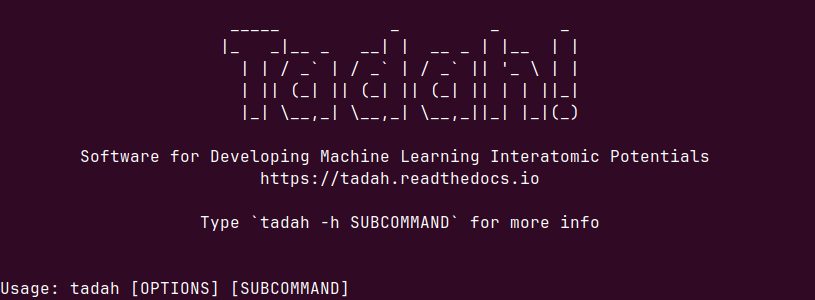

Welcome to the Tadah! Website
=============================

.. admonition:: Tadah! |release|
   :class: note

   This release is ready to use: the Tadah! authors fit and run potentials
   with it, and feedback on it is welcome. The C++ API is **not** stable
   and may change.

   The :doc:`changelog` lists what changes on moving from the earlier
   releases, the breaking changes first.
   `Issue reports <report any issues_>`_ are welcome.

   .. _report any issues: https://github.com/tadah-project/tadah.mlip/issues

This is the home of Tadah! software, used for developing and deploying machine learning interatomic potentials. This website provides documentation with examples to help users quickly get up to speed, along with an associated API for developers.

This site also publishes selected interatomic potentials developed by |gja_link| using Tadah! software, listed in :ref:`mlips`.

.. |gja_link| raw:: html

   <a href="https://www.ph.ed.ac.uk/people/graeme-ackland" target="_blank" style="text-decoration:none;">
       Prof. Ackland's group
   </a>

.. toctree::
   :maxdepth: 2
   :caption: General Information

   intro.rst
   installation.rst
   mlips.rst
   contribute.rst
   glossary.rst
   changelog.md
   LICENSE.rst

----

.. toctree::
   :maxdepth: 2
   :caption: How to Use Tadah!

   quickstart.rst
   cli/cli.rst
   tutorials.rst
   examples.rst
   config/config_keys.rst
   training.rst
   fit_objective.rst
   fit_balance.rst
   regressors.rst
   descriptors.rst
   dm_embed.rst
   cutoffs.rst
   refit.rst

----

.. toctree::
   :maxdepth: 2
   :caption: Nested Fitting
   :titlesonly:

   nfp/overview.rst
   nfp/quickstart.rst
   nfp/tutorial/index.rst
   nfp/examples/index.rst
   nfp/target_file.rst
   nfp/search_space.rst
   nfp/targets_losses.rst
   nfp/optimizer_block.rst
   nfp/choosing/index.rst
   nfp/output_files.rst
   nfp/reference/index.rst

----

.. toctree::
   :maxdepth: 2
   :caption: API
   :hidden:

   API_quickstart.rst
   API_examples.rst

.. toctree::
   :maxdepth: 2
   :caption: API Reference
   :hidden:

   API/atom.rst
   API/basisfunctions.rst
   API/config.rst
   API/cutoffs.rst
   API/descriptors.rst
   API/descriptors_calc.rst
   API/design_matrix.rst
   API/func_base.rst
   API/kernels.rst
   API/models.rst
   API/nn_finder.rst
   API/structure.rst
   API/structure_db.rst
   API/st_descriptors.rst
   API/st_descriptors_db.rst
