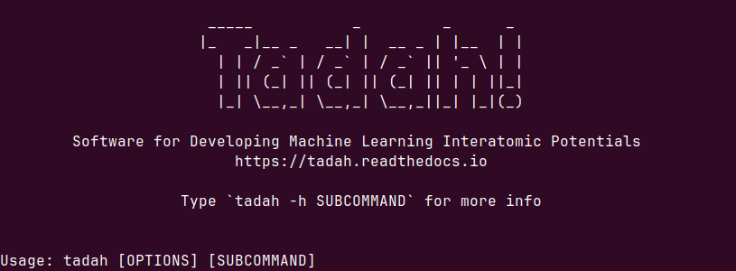

Welcome to the Tadah! Website
=============================

This is the home of Tadah! software, used for developing machine learning interatomic potentials. This website provides comprehensive documentation with examples to help users quickly get up to speed, along with an associated API for developers.

Here we also publish selected interatomic potentials developed by 

.. raw:: html

   <a href="https://www.ph.ed.ac.uk/people/graeme-ackland" target="_blank" style="text-decoration:none;">
       Prof. Ackland's group
       🔗
   </a>

using Tadah! software.

.. seealso:: 
   For our interatomic potentials, see :ref:`mlips`.

.. toctree::
   :maxdepth: 2
   :caption: General Information

   intro.rst
   installation.rst
   contribute.rst
   LICENSE.rst
   mlips.rst

----

.. toctree::
   :maxdepth: 2
   :caption: How to Use Tadah!

   quickstart.rst
   cli.rst
   tutorials.rst
   examples.rst
   config/config_keys.rst
   regressors.rst
   descriptors.rst
   cutoffs.rst
   hpo.rst

----

.. toctree::
   :maxdepth: 2
   :caption: API Reference

   API/atom.rst
   API/basisfunctions.rst
   API/config.rst
   API/cutoffs.rst
   API/descriptors.rst
   API/descriptors_calc.rst
   API/design_matrix.rst
   API/func_base.rst
   API/kernels.rst
   API/models.rst
   API/nn_finder.rst
   API/structure.rst
   API/structure_db.rst
   API/st_descriptors.rst
   API/st_descriptors_db.rst

Indices and Tables
==================

* :ref:`genindex`
* :ref:`modindex`
* :ref:`search`
