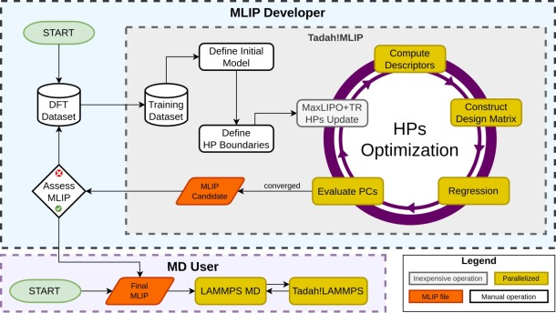

.. _nested_fitting:

Overview
========

Nested fitting chooses the settings of a potential that a fit does not
determine, such as its cutoffs. This page explains how it works, when it
pays off, its files and the build it needs; it assumes the fit of
``tadah train`` (:ref:`training`).

.. contents::
   :local:
   :depth: 1
   :backlinks: none

How nested fitting works
------------------------

A fit determines the coefficients of a potential from the training data
for fixed settings: the cutoffs, the descriptor widths and the other
:term:`hyperparameters <hyperparameter>`. Nested fitting puts that fit
inside a search over the hyperparameters. The command is ``tadah hpo``.

Each fit is the fit of ``tadah train``: for one set of values of the
settings, regression determines the coefficients
(:ref:`nfp_training_hpo_fit`). The search is run by an optimiser. It
proposes values of the :term:`search parameters <search parameter>`, the
settings of the :term:`training configuration` named on :hpo:key:`OPTIM`
lines, each with its bounds (:ref:`nfp_search_space`).

For each candidate, one set of these values, ``tadah hpo`` as a rule
trains a potential and computes its loss: one :term:`evaluation`. The
loss is one number made of :term:`loss terms <loss term>`. Each loss
term measures validation errors, a result of a LAMMPS script
(:hpo:key:`PC_LAMMPS`) or an observable that ``tadah hpo`` computes
itself (:hpo:key:`PC_OBSERVABLE`). :ref:`nfp_targets` describes the loss
terms. Most optimisers use the losses so far to propose the next values;
a grid or random search proposes them in a fixed order or at random
(:ref:`nfp_choosing`). The run keeps the potential with the smallest
loss, the :term:`best potential`.

         evaluation of the targets, driven by an optimiser that updates
         the hyperparameters, inside the workflow from DFT data to MD.
   :align: center
   :target: ../_images/nested_fitting.jpg

   Nested fitting in the workflow of a potential. The loop repeats the fit
   (descriptors, design matrix, regression) and the evaluation of the
   targets for each set of hyperparameters (HPs). The optimiser, here
   :hpo:opt:`DLIB:GFS` (MaxLIPO+TR), proposes each set. The figure's PCs
   (performance constraints) are the loss terms. A search ends at one of
   its stops, such as a number of evaluations
   (:ref:`nfp_optimizer_block_budgets`); :hpo:opt:`!DLIB:GFS` has no
   convergence test.

When to use it
--------------

Nested fitting suits a potential whose quality depends on several
settings that interact, such as the cutoffs and the width of a many-body
density. A search tries combinations that a scan by hand would leave out,
and the journal of the run records how the settings were chosen.

It also suits a potential that has to reproduce properties the training
data do not hold directly, such as elastic constants or a vacancy
formation energy. A LAMMPS script computes such a property for each
trained potential, and its deviation from a reference value becomes a
loss term (:ref:`nfp_targets_scripts`; worked in :ref:`nfp_unit_4`).

Each evaluation costs one fit and the computation of its loss terms, such
as a prediction of the validation data or a LAMMPS run, and a search needs
many evaluations. A search cannot make up for training data that miss the
structures of interest. Its result also depends on the loss terms and on
the bounds of the search parameters.

.. _nfp_overview_loss_data:

Data read by the loss
---------------------

Every dataset that a loss term reads is part of the fitting: the search
chooses the settings that make the potential good on it. A search that
tries many settings can fit the validation data, as a fit can fit its
training data.

The validation errors of the best potential are therefore no independent
measure of its accuracy. That measure comes from a test set that no loss
term reads, predicted with the best potential after the run
(:ref:`prediction`). :ref:`nfp_unit_3` tests the best potential on such
data.

The input files
---------------

``tadah hpo`` reads the training configuration and the target file in
every run, and the validation configuration when one is given; a loss
term on validation errors needs it:

Training configuration (``--config``)
   The data, the descriptors and the model of each fit, written as
   for ``tadah train`` (:ref:`config_file`, keys in
   :ref:`ConfigSection`); :ref:`training_hpo` describes how ``tadah hpo``
   uses it.
:term:`Validation configuration <validation configuration>` (``--validation``)
   The validation datasets (:ref:`validation`).
:term:`Target file <target file>` (``--hpotarget``)
   The search parameters, the loss terms and the optimiser of the search
   (:ref:`nfp_target_file`). It is called ``config.hpo`` by convention.

The command-line options of ``tadah hpo`` are listed in the
:ref:`command reference <cli_hpo>`.

What a run produces
-------------------

A run writes the best potential to ``best_pot.tadah``; ``tadah predict``
(:ref:`prediction`) and LAMMPS (:ref:`lammps_usage`) use it as any other
potential. The journal, ``hpo_run.log``, and the history files record the run
and its evaluations.
:ref:`nfp_output` describes every file and how a run ends.

Requirements
------------

``tadah hpo`` runs only in a Tadah! build with Nested Fitting, which
needs a LAMMPS library (:ref:`installation_nfp`).

The :ref:`nfp_quickstart` runs a first search.
