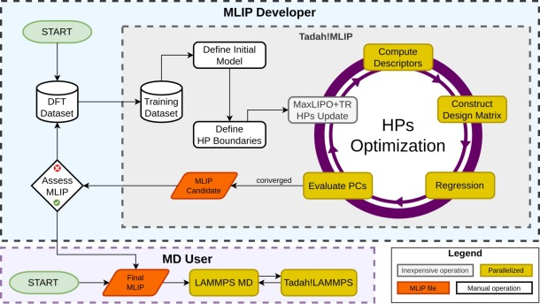

.. _background:

.. _nested_fitting:

Overview
========

This page explains what nested fitting does and which files a run needs.
It assumes a training configuration (see :ref:`config_file`).

Nested fitting searches the values of training-configuration keys, the
search parameters, to minimise a configured loss. The command is
``tadah hpo``. It applies when a setting that regression does not find,
such as a cut-off, is to be chosen by the quality of the resulting
potential.

For each candidate, the outer optimiser changes the parameters selected
by ``OPTIM``. The inner fit solves the model's free coefficients using
the training configuration. The resulting potential is scored against
validation metrics or physical-property targets, and that loss guides
the next candidate.

   Nested fitting workflow illustrated with the ``DLIB:GFS`` optimiser,
   Dlib's global search (MaxLIPO with a trust-region search).

.. _what-you-configure:

Input files
-----------

Training configuration
   The ``--config`` file: the model, the training datasets and the
   regression settings (see :ref:`config_file`).

Validation configuration
   The ``--validation`` file: the validation datasets, required when a
   validation metric is enabled (see :doc:`nfp_validation_targets`).

Target file
   The ``--hpotarget`` file: the search parameters, the targets and the
   optimiser (see :doc:`nfp_configuration`).

A run writes the best potential, ``best_pot.tadah``, and the run log
``hpo_run.log`` (see :doc:`nfp_output_settings`).

Configuration components
------------------------

.. list-table::
   :header-rows: 1
   :widths: 35 65

   * - Part of the run
     - Reference
   * - Input files and command
     - :doc:`nfp_quickstart`
   * - File format and nesting
     - :doc:`nfp_configuration`
   * - Parameters the search may vary
     - :doc:`nfp_search_space`
   * - Quantities each potential should reproduce
     - :doc:`nfp_objective`
   * - Algorithm, starting points and strategy
     - :doc:`nfp_optimisation`
   * - Saved potentials and histories
     - :doc:`nfp_output_settings`

For successful evaluations, the total loss is the arithmetic mean of
the weighted loss terms. A failed target can fail the whole evaluation.
Target units and scales determine suitable loss-term weights; the exact
rules are in :doc:`nfp_losses`.

Data that decides the values of the search parameters is part of fitting
(see :doc:`nfp_validation_targets`). An independent test set or set of
properties provides an assessment of the final potential.

Next: :doc:`nfp_quickstart`.
